# Bestiary

Every creature in the game: its body from the front and the side, every clip its body plays with its length, and its flavour, the fantasy line of its design sheet (`docs/design/souls/`). Where a sheet has none the page says "Flavour: not written yet". Filed as E-0.15.

| | Creature | What it is | Flavour |
|---|---|---|---|
| 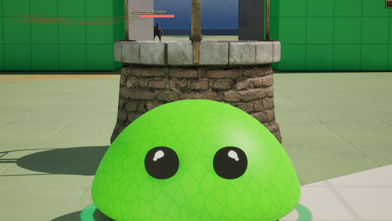 | [Slime](slime.md) | the player with no soul | Flavour: not written yet. |
| 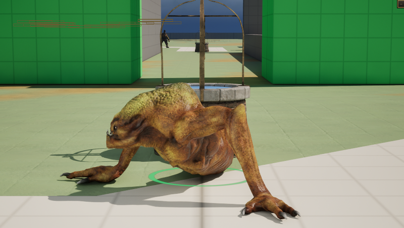 | [Creepy](creepy.md) | soul | You are a low, long, many-legged venomous crawler: you leap out of the dark, leave everything you touch rotting, and are already somewhere else when it dies. |
| 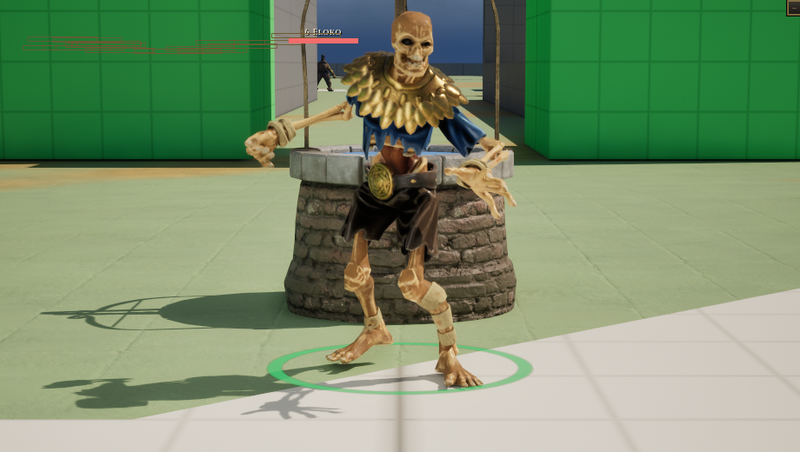 | [Corpse](corpse.md) | soul | You are a normal skeleton, but can be very mobile and make bones become splinters or focus on bone magic to make powerful projectiles. |
| 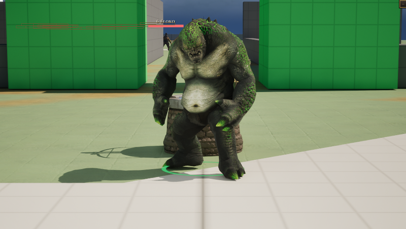 | [Ogre](ogre.md) | soul | You are the biggest thing in the room: every swing takes a second to arrive, nothing that hits you during it matters, and anything small enough goes in your mouth. |
| 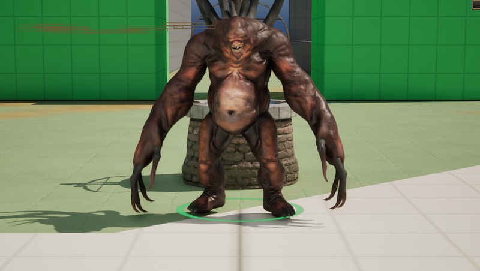 | [Gargoyle](gargoyle.md) | soul | You are a ton of carved stone that is either perfectly still or falling on someone, and everything you touch ends up as still as you are. |
| 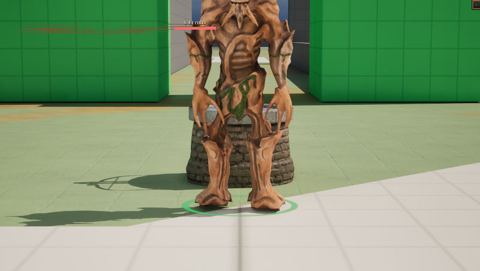 | [Treant](treant.md) | soul | You are a walking grove: slow, enormous and never in a hurry, because the ground under the fight belongs to you, and everything that grows there answers when you call. |
| 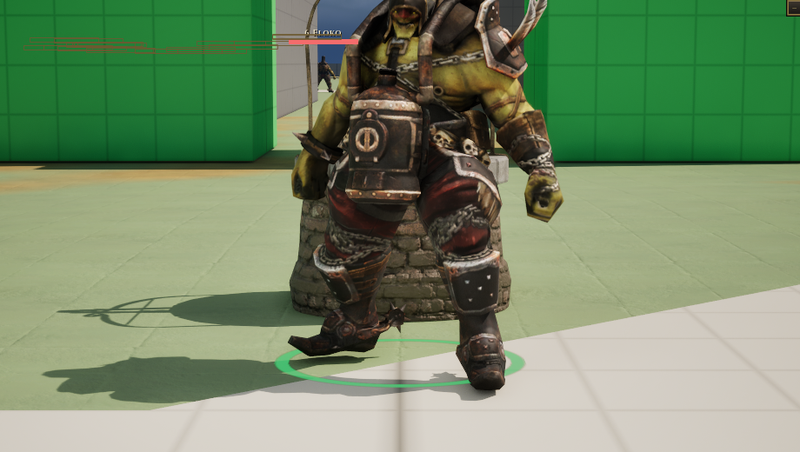 | [Eloko](eloko.md) | soul | You are a knee-high thing in a coat of grass with too many teeth and one small bell: you never chase, you ring, and whatever hears it walks over to work for you or to be eaten. |
| 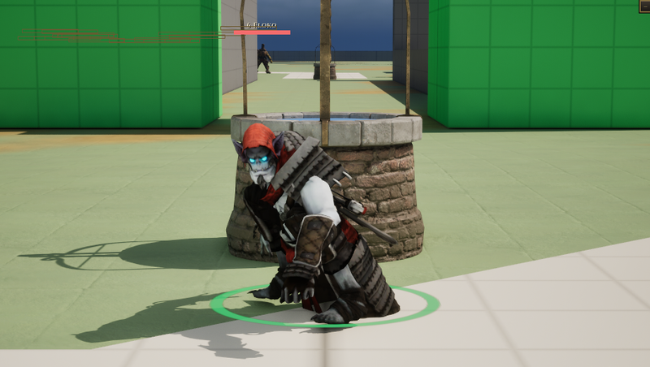 | [Vampire](vampire.md) | soul | You are a patient, well-dressed predator for whom every enemy's health bar is a glass someone else is holding for you, and your own is a debt you enjoy running up. |
| 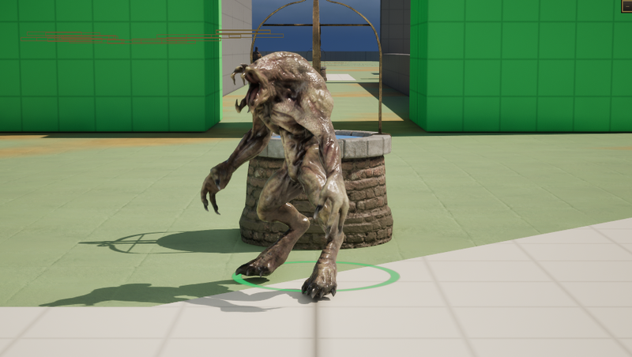 | [Vetala](vetala.md) | soul | You are not the body, you are the thing riding it: a gaunt bat-winged spirit that hangs upside down, asks questions nobody survives, and drives each borrowed corpse until it comes apart, then takes the next. |
| 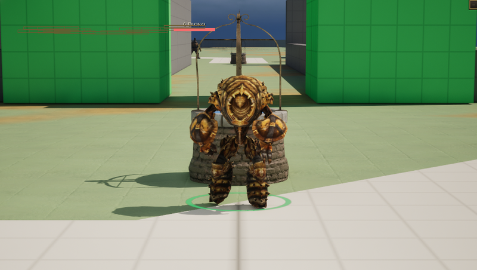 | [Golem](golem.md) | soul | You are the slowest thing on the field and the only thing on it that does not move when hit: the ground breaks where you say, and whatever strikes you regrets it. |
| 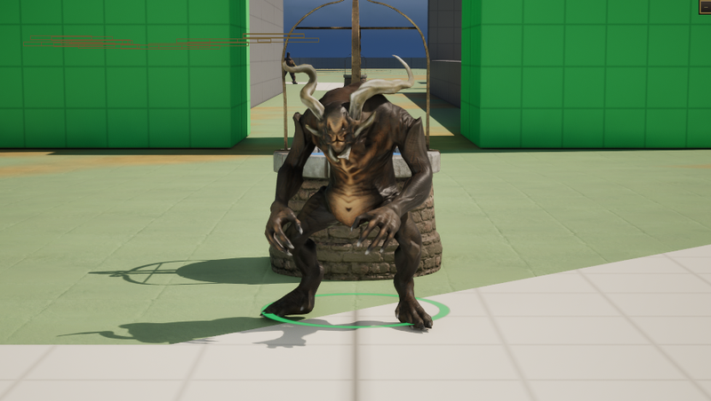 | [Oni](oni.md) | soul | You are the masked demon that comes down the mountain faster than anything that size should, a kanabo in one fist and weather in the other, and the longer you keep swinging the worse it gets for everyone nearby, you included. |
| 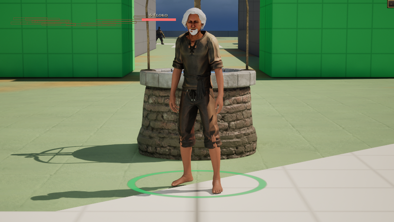 | [Walter](walter.md) | human body | Flavour: not written yet. |
| 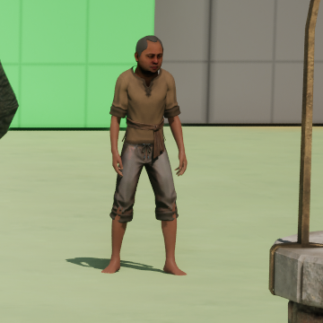 | [Jorge](jorge.md) | human body | Flavour: not written yet. |

<!-- drops: written by scripts/gen_monster_catalogue.py from the data; edit the data, not this block -->
## What drops

**How to read the drops.** Each soul's page lists what its monsters drop in each zone they stand in, a kill at a time. Nothing on it is typed by hand: `scripts/gen_monster_catalogue.py` works it out from the tables and settings the game reads (where each monster stands in `DT_SpawnTable`, the zone levels in `DT_Areas`, the tier steps in `DT_GemTierLevels`, `DT_MonsterStats`, `DT_AffixRollRules` and the drop settings in `DefaultGame.ini`), with the host's Drop rates at its default, 1, and tier1 fails when a page is out of date. The numbers are placeholders, like the rules behind them. A gem's tier comes from the zone, not from the monster's level: the top of the zone's level range gives the zone's tier, and a gem lands 80 % at the zone's tier, 20 % a tier below; an Elite adds a tier and a Boss 2 tiers, up to tier X. In the starter cave nothing drops above tier I. "Gems" is the chance a kill drops at least one gem, then how many it drops on average; tier, rarity and colour are shares of those gems; bench items and soul fragments are chances a kill. A gem's lines take their tiers by the weights 60 / 30 / 10, for the gem's own tier and each tier under it in turn, never more than 2 tiers under the gem's and never under tier I, among the tiers a line has. In co-op every player who hit the monster rolls their own gems and bench items at these odds; the fragment goes to the player who made the kill. `Slime.LootSim` rolls the same odds through the game's own code.

| Zone | Levels | Zone's tier | Normal | Elite | Boss | Colour |
|---|---|---|---|---|---|---|
| Beach | 1 to 5 | I | I 100 % | II 100 % | III 100 % | Red 31.7 %, Blue 31.7 %, Green 31.7 %, Iridescent 5 % |
| Fields | 6 to 10 | II | II 80 %, I 20 % | III 80 %, II 20 % | IV 80 %, III 20 % | Red 31.7 %, Blue 31.7 %, Green 31.7 %, Iridescent 5 % |
| Jungle | 11 to 15 | III | III 80 %, II 20 % | IV 80 %, III 20 % | V 80 %, IV 20 % | Red 31.7 %, Blue 31.7 %, Green 31.7 %, Iridescent 5 % |
| Pass | 16 to 20 | IV | IV 80 %, III 20 % | V 80 %, IV 20 % | VI 80 %, V 20 % | Red 31.7 %, Blue 31.7 %, Green 31.7 %, Iridescent 5 % |
| Starter cave | the monster's own | by level, capped | I 100 % | I 100 % | I 100 % | Red 31.7 %, Blue 31.7 %, Green 31.7 %, Iridescent 5 % |

In every zone, gems a kill: Normal 40 %, 0.40 a kill; Elite certain, 1.40 a kill; Boss certain, 3.00 a kill. Bench items a kill: Normal Etching Needle 2 %, Expanding Lattice 3 %, Polishing Wheel 1.5 %; Elite Etching Needle 15 %, Expanding Lattice 20 %, Polishing Wheel 10 %; Boss Etching Needle 1 certain, Expanding Lattice 1 certain, Polishing Wheel 1 certain.

Not in the spawn table, so not on a page: `DA_Monster_Corpse_Lone`, `DA_Monster_Corpse_Weak`, `DA_Monster_Eloko_Elite`, `DA_Monster_Vetala_Elite`, `DA_Monster_Bonewalker`, `DA_Monster_Sapling`.
<!-- drops end -->

## What is left

- Stills, not animated previews: no clip is shown in motion, and there is no contact sheet a clip.
- Flavour for the slime, Walter and Jorge is not written: no design sheet names it.
- The pictures are in the grey-box town; field monsters and the town well stand behind some bodies.

Pictures are frames from a game rendered off screen on 2026-10-28, the body standing idle in the town (grey-box map), HUD cropped away. Clip lengths are seconds at play rate 1, read from the clip assets (`Data/Authoring/Souls/clips.json` and `body-clips.json` for the souls).
