# Bestiary

Every creature in the game: its body from the front and the side, every clip its body plays with its length, and its flavour, the fantasy line of its design sheet (`docs/design/souls/`). Where a sheet has none the page says "Flavour: not written yet". Filed as E-0.15.

| | Creature | What it is | Flavour |
|---|---|---|---|
| 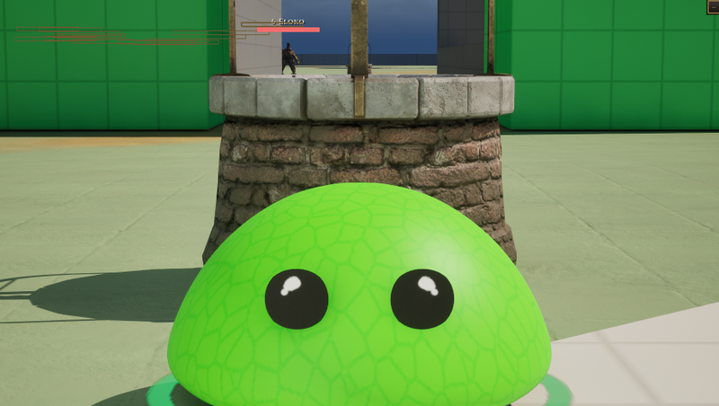 | [Slime](slime.md) | the player with no soul | Flavour: not written yet. |
| 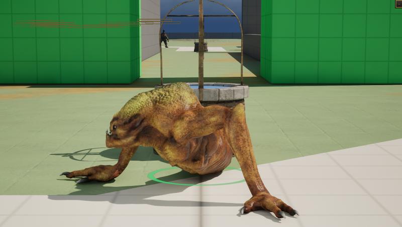 | [Creepy](creepy.md) | soul | You are a low, long, many-legged venomous crawler: you leap out of the dark, leave everything you touch rotting, and are already somewhere else when it dies. |
|  | [Corpse](corpse.md) | soul | You are a normal skeleton, but can be very mobile and make bones become splinters or focus on bone magic to make powerful projectiles. |
| 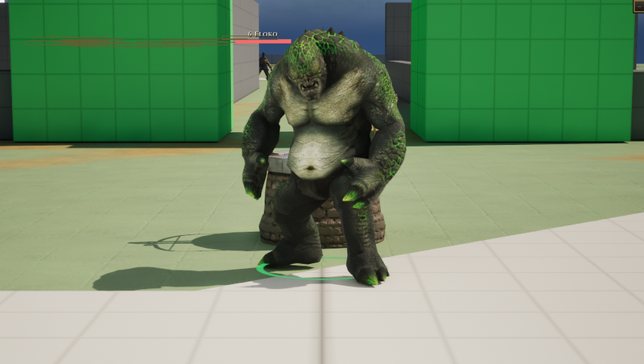 | [Ogre](ogre.md) | soul | You are the biggest thing in the room: every swing takes a second to arrive, nothing that hits you during it matters, and anything small enough goes in your mouth. |
| 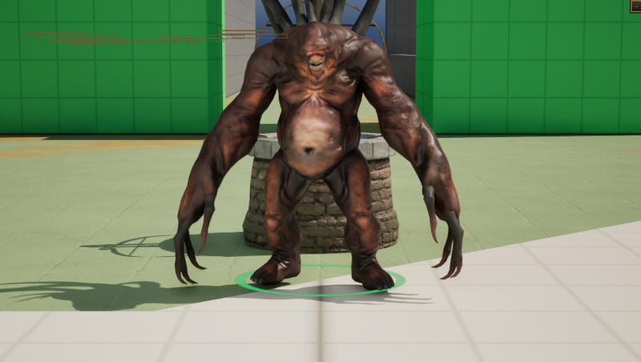 | [Gargoyle](gargoyle.md) | soul | You are a ton of carved stone that is either perfectly still or falling on someone, and everything you touch ends up as still as you are. |
| 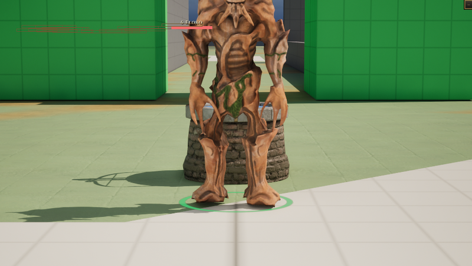 | [Treant](treant.md) | soul | You are a walking grove: slow, enormous and never in a hurry, because the ground under the fight belongs to you, and everything that grows there answers when you call. |
| 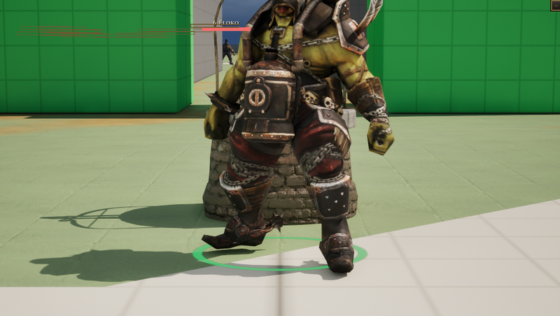 | [Eloko](eloko.md) | soul | You are a knee-high thing in a coat of grass with too many teeth and one small bell: you never chase, you ring, and whatever hears it walks over to work for you or to be eaten. |
| 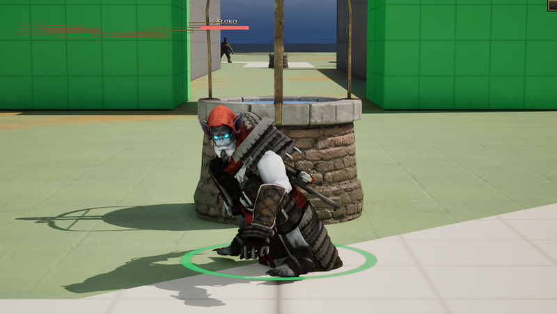 | [Vampire](vampire.md) | soul | You are a patient, well-dressed predator for whom every enemy's health bar is a glass someone else is holding for you, and your own is a debt you enjoy running up. |
| 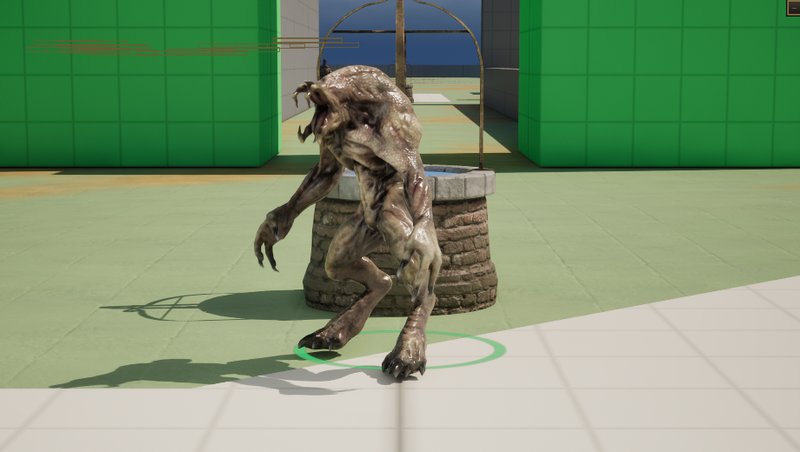 | [Vetala](vetala.md) | soul | You are not the body, you are the thing riding it: a gaunt bat-winged spirit that hangs upside down, asks questions nobody survives, and drives each borrowed corpse until it comes apart, then takes the next. |
| 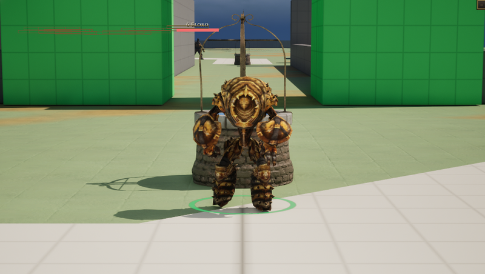 | [Golem](golem.md) | soul | You are the slowest thing on the field and the only thing on it that does not move when hit: the ground breaks where you say, and whatever strikes you regrets it. |
| 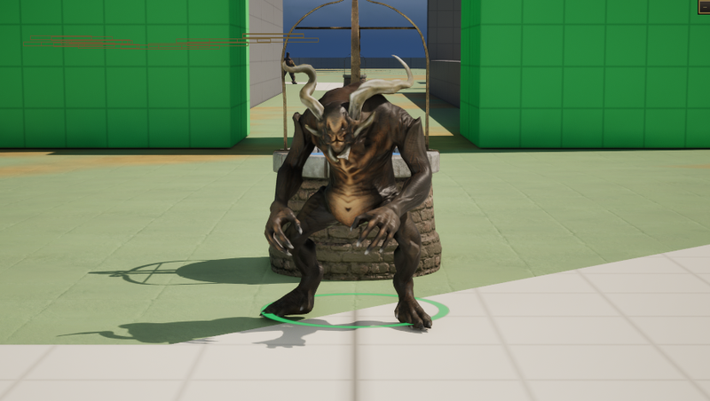 | [Oni](oni.md) | soul | You are the masked demon that comes down the mountain faster than anything that size should, a kanabo in one fist and weather in the other, and the longer you keep swinging the worse it gets for everyone nearby, you included. |
| 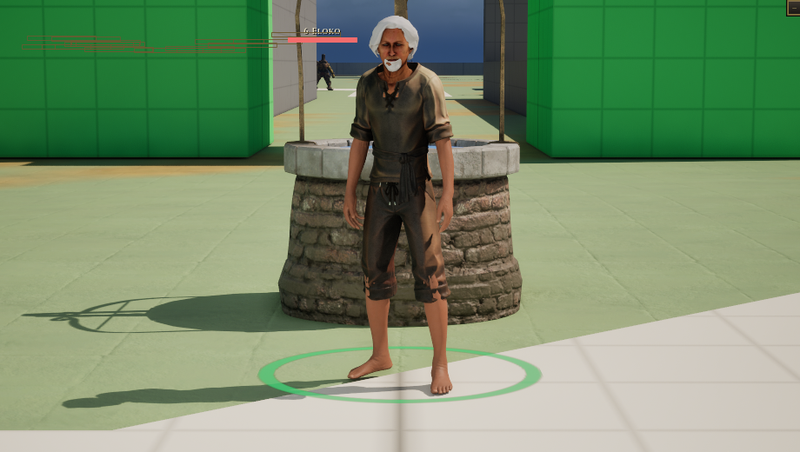 | [Walter](walter.md) | human body | Flavour: not written yet. |
| 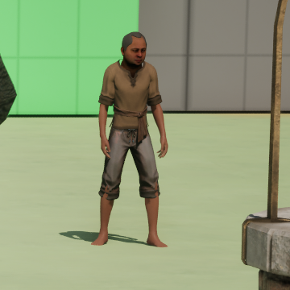 | [Jorge](jorge.md) | human body | Flavour: not written yet. |

## What is left

- Stills, not animated previews: no clip is shown in motion, and there is no contact sheet a clip.
- Flavour for the slime, Walter and Jorge is not written: no design sheet names it.
- The pictures are in the grey-box town; field monsters and the town well stand behind some bodies.

Pictures are frames from a game rendered off screen on 2026-10-28, the body standing idle in the town (grey-box map), HUD cropped away. Clip lengths are seconds at play rate 1, read from the clip assets (`Data/Authoring/Souls/clips.json` and `body-clips.json` for the souls).
