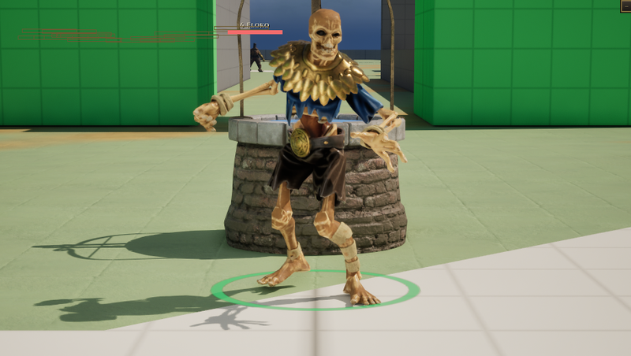
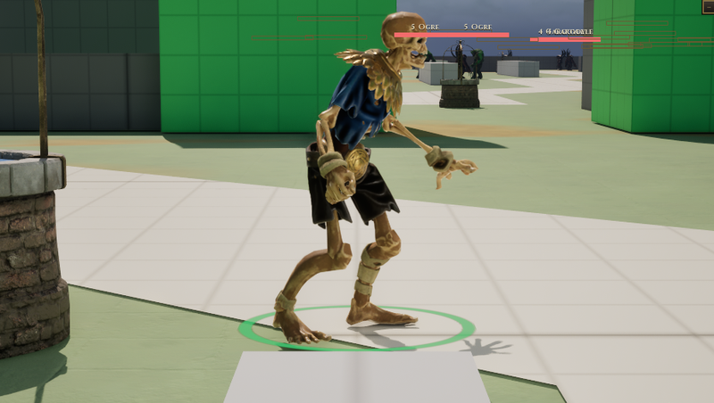

# Corpse

[Bestiary](README.md)

**Flavour.** You are a normal skeleton, but can be very mobile and make bones become splinters or focus on bone magic to make powerful projectiles.

 

## Clips its body plays

| Use | Clip | Seconds |
|---|---|---|
| idle | `Corpse_alert_idle` | 1.33 |
| walk | `Corpse_Run_Forward` | 0.73 |
| run | `Corpse_Run_Forward` | 0.73 |
| hit | `Corpse_Alert_Stun_Knock_Back` | 1.00 |
| death | `Corpse_Alert_Death3` | 0.67 |
| attack light | `Corpse_Alert_Attack_Basic01` | 1.33 |
| attack heavy | `Corpse_Alert_Attack_Slow` | 1.17 |
| attack alt | `Corpse_Alert_Attack_Push` | 0.80 |
| cast | `Corpse_Alert_Taunt` | 1.03 |
| roar | `Corpse_Alert_Taunt` | 1.03 |
| dash | `Corpse_Alert_Attack_Approach` | 1.17 |

Note on the body: The pack has no walk clip (run stands in). idle, run, death, Basic01, Push, Taunt and Approach are what DA_Soul_Corpse names today; hit and attack_heavy are picked by file name, unseen.

Its skeleton carries 49 clips in all (`Data/Authoring/Souls/body-clips.json`); the table lists the ones the soul names.

Design sheet: `docs/design/souls/corpse.md` in the repository. Mesh `Corpse_Sword`.

Pictures are frames from a game rendered off screen on 2026-10-28, the body standing idle in the town (grey-box map), HUD cropped away. Clip lengths are seconds at play rate 1, read from the clip assets (`Data/Authoring/Souls/clips.json` and `body-clips.json` for the souls).
