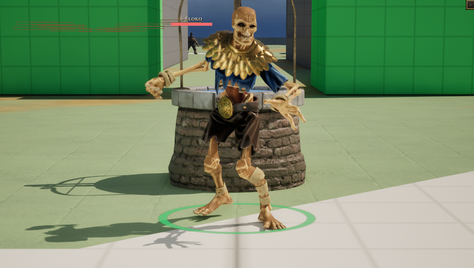
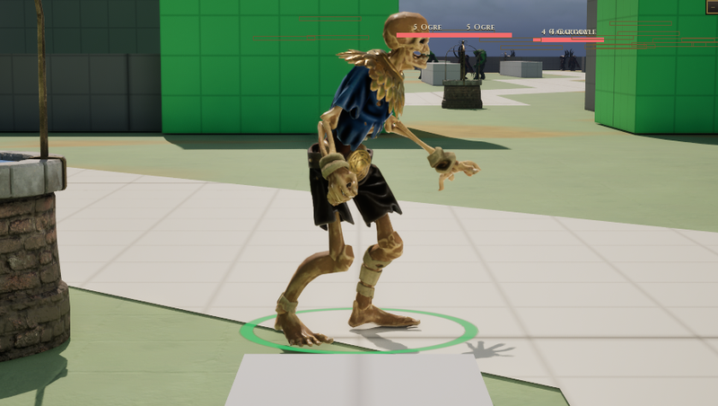

# Corpse

[Bestiary](README.md)

**Flavour.** You are a normal skeleton, but can be very mobile and make bones become splinters or focus on bone magic to make powerful projectiles.

 

## Clips its body plays

| Use | Clip | Seconds |
|---|---|---|
| idle | `Corpse_alert_idle` | 1.33 |
| walk | `Corpse_Run_Forward` | 0.73 |
| run | `Corpse_Run_Forward` | 0.73 |
| hit | `Corpse_Alert_Stun_Knock_Back` | 1.00 |
| death | `Corpse_Alert_Death3` | 0.67 |
| attack light | `Corpse_Alert_Attack_Basic01` | 1.33 |
| attack heavy | `Corpse_Alert_Attack_Slow` | 1.17 |
| attack alt | `Corpse_Alert_Attack_Push` | 0.80 |
| cast | `Corpse_Alert_Taunt` | 1.03 |
| roar | `Corpse_Alert_Taunt` | 1.03 |
| dash | `Corpse_Alert_Attack_Approach` | 1.17 |

Note on the body: The pack has no walk clip (run stands in). idle, run, death, Basic01, Push, Taunt and Approach are what DA_Soul_Corpse names today; hit and attack_heavy are picked by file name, unseen.

Its skeleton carries 49 clips in all (`Data/Authoring/Souls/body-clips.json`); the table lists the ones the soul names.

<!-- drops: written by scripts/gen_monster_catalogue.py from the data; edit the data, not this block -->
## What it drops

A kill at a time, by the zone it stands in; how to read it, and the odds zone by zone, are on the [bestiary index](README.md#what-drops). Every number is a placeholder, worked out from the tables the game reads.

| Monster | Zone | Class | Gems | Gem tier | Rarity | Colour | Bench items | Soul |
|---|---|---|---|---|---|---|---|---|
| `DA_Monster_Corpse` | Beach | Normal | 40 %, 0.40 a kill | I 100 % | Normal 60 %, Magic 30 %, Rare 10 % | Red 31.7 %, Blue 31.7 %, Green 31.7 %, Iridescent 5 % | Etching Needle 2 % Expanding Lattice 3 % Polishing Wheel 1.5 % | 20 % a Corpse fragment; 3 make a soul (about 15 kills) |
| `DA_Monster_Corpse` | Fields | Normal | 40 %, 0.40 a kill | II 80 %, I 20 % | Normal 60 %, Magic 30 %, Rare 10 % | Red 31.7 %, Blue 31.7 %, Green 31.7 %, Iridescent 5 % | Etching Needle 2 % Expanding Lattice 3 % Polishing Wheel 1.5 % | 20 % a Corpse fragment; 3 make a soul (about 15 kills) |
| `DA_Monster_Corpse` | Jungle | Normal | 40 %, 0.40 a kill | III 80 %, II 20 % | Normal 60 %, Magic 30 %, Rare 10 % | Red 31.7 %, Blue 31.7 %, Green 31.7 %, Iridescent 5 % | Etching Needle 2 % Expanding Lattice 3 % Polishing Wheel 1.5 % | 20 % a Corpse fragment; 3 make a soul (about 15 kills) |
| `DA_Monster_Corpse` | Pass | Normal | 40 %, 0.40 a kill | IV 80 %, III 20 % | Normal 60 %, Magic 30 %, Rare 10 % | Red 31.7 %, Blue 31.7 %, Green 31.7 %, Iridescent 5 % | Etching Needle 2 % Expanding Lattice 3 % Polishing Wheel 1.5 % | 20 % a Corpse fragment; 3 make a soul (about 15 kills) |
| `DA_Monster_Corpse_Beach` | Beach | Normal | 40 %, 0.40 a kill | I 100 % | Normal 60 %, Magic 30 %, Rare 10 % | Red 31.7 %, Blue 31.7 %, Green 31.7 %, Iridescent 5 % | Etching Needle 2 % Expanding Lattice 3 % Polishing Wheel 1.5 % | 20 % a Corpse fragment; 3 make a soul (about 15 kills) |
| `DA_Monster_Corpse_Elite` | Beach | Elite | certain, 1.40 a kill | II 100 % | Normal 25 %, Magic 50 %, Rare 25 % | Red 31.7 %, Blue 31.7 %, Green 31.7 %, Iridescent 5 % | Etching Needle 15 % Expanding Lattice 20 % Polishing Wheel 10 % | 100 % a Corpse fragment; 3 make a soul (about 3 kills) |
| `DA_Monster_Corpse_Fields` | Fields | Normal | 40 %, 0.40 a kill | II 80 %, I 20 % | Normal 60 %, Magic 30 %, Rare 10 % | Red 31.7 %, Blue 31.7 %, Green 31.7 %, Iridescent 5 % | Etching Needle 2 % Expanding Lattice 3 % Polishing Wheel 1.5 % | 20 % a Corpse fragment; 3 make a soul (about 15 kills) |
| `DA_Monster_Corpse_FieldsElite` | Fields | Elite | certain, 1.40 a kill | III 80 %, II 20 % | Normal 25 %, Magic 50 %, Rare 25 % | Red 31.7 %, Blue 31.7 %, Green 31.7 %, Iridescent 5 % | Etching Needle 15 % Expanding Lattice 20 % Polishing Wheel 10 % | 100 % a Corpse fragment; 3 make a soul (about 3 kills) |
| `DA_Monster_Corpse_Jungle` | Jungle | Normal | 40 %, 0.40 a kill | III 80 %, II 20 % | Normal 60 %, Magic 30 %, Rare 10 % | Red 31.7 %, Blue 31.7 %, Green 31.7 %, Iridescent 5 % | Etching Needle 2 % Expanding Lattice 3 % Polishing Wheel 1.5 % | 20 % a Corpse fragment; 3 make a soul (about 15 kills) |
| `DA_Monster_Corpse_JungleElite` | Jungle | Elite | certain, 1.40 a kill | IV 80 %, III 20 % | Normal 25 %, Magic 50 %, Rare 25 % | Red 31.7 %, Blue 31.7 %, Green 31.7 %, Iridescent 5 % | Etching Needle 15 % Expanding Lattice 20 % Polishing Wheel 10 % | 100 % a Corpse fragment; 3 make a soul (about 3 kills) |
| `DA_Monster_Corpse_Pass` | Pass | Normal | 40 %, 0.40 a kill | IV 80 %, III 20 % | Normal 60 %, Magic 30 %, Rare 10 % | Red 31.7 %, Blue 31.7 %, Green 31.7 %, Iridescent 5 % | Etching Needle 2 % Expanding Lattice 3 % Polishing Wheel 1.5 % | 20 % a Corpse fragment; 3 make a soul (about 15 kills) |
| `DA_Monster_Corpse_PassElite` | Pass | Elite | certain, 1.40 a kill | V 80 %, IV 20 % | Normal 25 %, Magic 50 %, Rare 25 % | Red 31.7 %, Blue 31.7 %, Green 31.7 %, Iridescent 5 % | Etching Needle 15 % Expanding Lattice 20 % Polishing Wheel 10 % | 100 % a Corpse fragment; 3 make a soul (about 3 kills) |
| `DA_Monster_Corpse_Cave` | Starter cave | Normal | 40 %, 0.40 a kill; at least one from the first kill of a pack whose spawn row says so | I 100 % | Normal 60 %, Magic 30 %, Rare 10 % | Red 31.7 %, Blue 31.7 %, Green 31.7 %, Iridescent 5 % | Etching Needle 2 % Expanding Lattice 3 % Polishing Wheel 1.5 % | none |
<!-- drops end -->

Design sheet: `docs/design/souls/corpse.md` in the repository. Mesh `Corpse_Sword`.

Pictures are frames from a game rendered off screen on 2026-10-28, the body standing idle in the town (grey-box map), HUD cropped away. Clip lengths are seconds at play rate 1, read from the clip assets (`Data/Authoring/Souls/clips.json` and `body-clips.json` for the souls).
