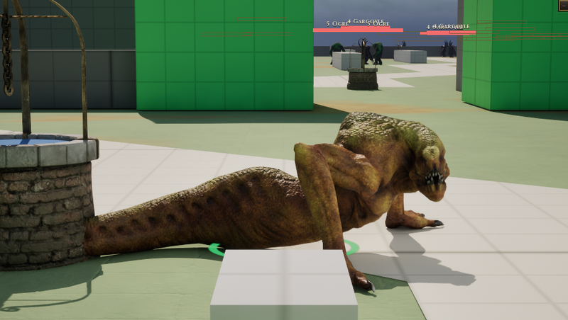

# Creepy

[Bestiary](README.md)

**Flavour.** You are a low, long, many-legged venomous crawler: you leap out of the dark, leave everything you touch rotting, and are already somewhere else when it dies.

 

## Clips its body plays

| Use | Clip | Seconds |
|---|---|---|
| idle | `Anim_Creepy_Idle` | 12.00 |
| walk | `Anim_Creepy_Walk` | 1.30 |
| run | `Anim_Creepy_Run` | 0.80 |
| hit | `Anim_Creepy_GetHit` | 1.00 |
| attack light | `Anim_Creepy_Attack_1_` | 1.33 |
| attack heavy | `Anim_Creepy_Attack_2_` | 1.33 |
| attack alt | `Anim_Creepy_Attack_3_` | 1.17 |
| cast | `Anim_Creepy_Shout` | 2.67 |
| roar | `Anim_Creepy_Shout` | 2.67 |
| dash | `Anim_Creepy_Run` | 0.80 |

Note on the body: SK_Creepy has no death clip (plan section 8); the death key is absent and the soul's DeathAnimation is left as it is.

Its skeleton carries 9 clips in all (`Data/Authoring/Souls/body-clips.json`); the table lists the ones the soul names.

Design sheet: `docs/design/souls/creepy.md` in the repository. Mesh `SK_Creepy`.

Pictures are frames from a game rendered off screen on 2026-10-28, the body standing idle in the town (grey-box map), HUD cropped away. Clip lengths are seconds at play rate 1, read from the clip assets (`Data/Authoring/Souls/clips.json` and `body-clips.json` for the souls).
