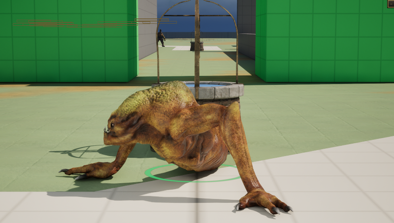
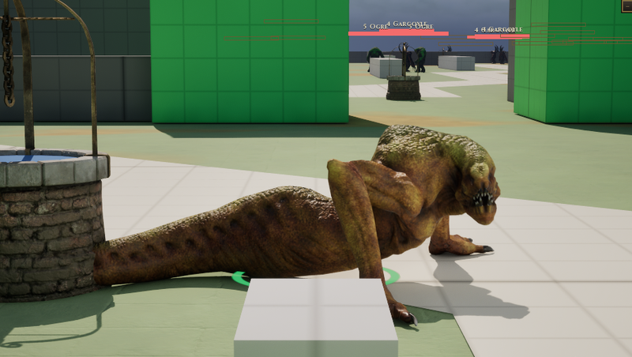

# Creepy

[Bestiary](README.md)

**Flavour.** You are a low, long, many-legged venomous crawler: you leap out of the dark, leave everything you touch rotting, and are already somewhere else when it dies.

 

## Clips its body plays

| Use | Clip | Seconds |
|---|---|---|
| idle | `Anim_Creepy_Idle` | 12.00 |
| walk | `Anim_Creepy_Walk` | 1.30 |
| run | `Anim_Creepy_Run` | 0.80 |
| hit | `Anim_Creepy_GetHit` | 1.00 |
| attack light | `Anim_Creepy_Attack_1_` | 1.33 |
| attack heavy | `Anim_Creepy_Attack_2_` | 1.33 |
| attack alt | `Anim_Creepy_Attack_3_` | 1.17 |
| cast | `Anim_Creepy_Shout` | 2.67 |
| roar | `Anim_Creepy_Shout` | 2.67 |
| dash | `Anim_Creepy_Run` | 0.80 |

Note on the body: SK_Creepy has no death clip (plan section 8); the death key is absent and the soul's DeathAnimation is left as it is.

Its skeleton carries 9 clips in all (`Data/Authoring/Souls/body-clips.json`); the table lists the ones the soul names.

<!-- drops: written by scripts/gen_monster_catalogue.py from the data; edit the data, not this block -->
## What it drops

A kill at a time, by the zone it stands in; how to read it, and the odds zone by zone, are on the [bestiary index](README.md#what-drops). Every number is a placeholder, worked out from the tables the game reads.

| Monster | Zone | Class | Gems | Gem tier | Rarity | Colour | Bench items | Soul |
|---|---|---|---|---|---|---|---|---|
| `DA_Monster_Creepy` | Beach | Normal | 40 %, 0.40 a kill | I 100 % | Normal 60 %, Magic 30 %, Rare 10 % | Red 31.7 %, Blue 31.7 %, Green 31.7 %, Iridescent 5 % | Etching Needle 2 % Expanding Lattice 3 % Polishing Wheel 1.5 % | 20 % a Creepy fragment; 3 make a soul (about 15 kills) |
| `DA_Monster_Creepy` | Fields | Normal | 40 %, 0.40 a kill | II 80 %, I 20 % | Normal 60 %, Magic 30 %, Rare 10 % | Red 31.7 %, Blue 31.7 %, Green 31.7 %, Iridescent 5 % | Etching Needle 2 % Expanding Lattice 3 % Polishing Wheel 1.5 % | 20 % a Creepy fragment; 3 make a soul (about 15 kills) |
| `DA_Monster_Creepy` | Jungle | Normal | 40 %, 0.40 a kill | III 80 %, II 20 % | Normal 60 %, Magic 30 %, Rare 10 % | Red 31.7 %, Blue 31.7 %, Green 31.7 %, Iridescent 5 % | Etching Needle 2 % Expanding Lattice 3 % Polishing Wheel 1.5 % | 20 % a Creepy fragment; 3 make a soul (about 15 kills) |
| `DA_Monster_Creepy` | Pass | Normal | 40 %, 0.40 a kill | IV 80 %, III 20 % | Normal 60 %, Magic 30 %, Rare 10 % | Red 31.7 %, Blue 31.7 %, Green 31.7 %, Iridescent 5 % | Etching Needle 2 % Expanding Lattice 3 % Polishing Wheel 1.5 % | 20 % a Creepy fragment; 3 make a soul (about 15 kills) |
| `DA_Monster_Creepy_Fields` | Fields | Normal | 40 %, 0.40 a kill | II 80 %, I 20 % | Normal 60 %, Magic 30 %, Rare 10 % | Red 31.7 %, Blue 31.7 %, Green 31.7 %, Iridescent 5 % | Etching Needle 2 % Expanding Lattice 3 % Polishing Wheel 1.5 % | 20 % a Creepy fragment; 3 make a soul (about 15 kills) |
| `DA_Monster_Creepy_Jungle` | Jungle | Normal | 40 %, 0.40 a kill | III 80 %, II 20 % | Normal 60 %, Magic 30 %, Rare 10 % | Red 31.7 %, Blue 31.7 %, Green 31.7 %, Iridescent 5 % | Etching Needle 2 % Expanding Lattice 3 % Polishing Wheel 1.5 % | 20 % a Creepy fragment; 3 make a soul (about 15 kills) |
| `DA_Monster_Creepy_Pass` | Pass | Normal | 40 %, 0.40 a kill | IV 80 %, III 20 % | Normal 60 %, Magic 30 %, Rare 10 % | Red 31.7 %, Blue 31.7 %, Green 31.7 %, Iridescent 5 % | Etching Needle 2 % Expanding Lattice 3 % Polishing Wheel 1.5 % | 20 % a Creepy fragment; 3 make a soul (about 15 kills) |
| Cave Creepy (`DA_Monster_Creepy_CaveBoss`) | Starter cave | Boss | certain, 3.00 a kill | I 100 % | Magic 40 %, Rare 60 % | Red 31.7 %, Blue 31.7 %, Green 31.7 %, Iridescent 5 % | Etching Needle 1 certain Expanding Lattice 1 certain Polishing Wheel 1 certain | a whole Creepy, certain |
<!-- drops end -->

Design sheet: `docs/design/souls/creepy.md` in the repository. Mesh `SK_Creepy`.

Pictures are frames from a game rendered off screen on 2026-10-28, the body standing idle in the town (grey-box map), HUD cropped away. Clip lengths are seconds at play rate 1, read from the clip assets (`Data/Authoring/Souls/clips.json` and `body-clips.json` for the souls).
