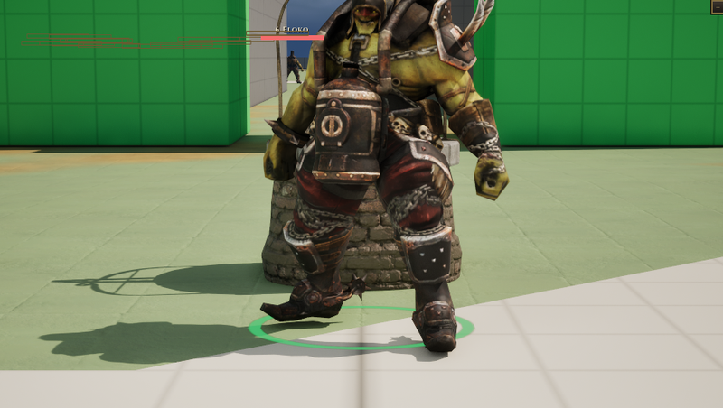
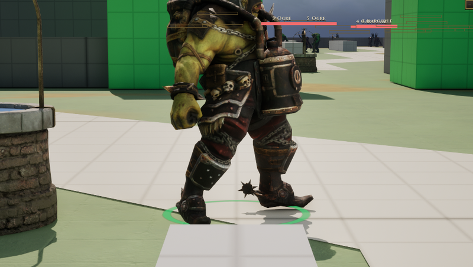

# Eloko

[Bestiary](README.md)

**Flavour.** You are a knee-high thing in a coat of grass with too many teeth and one small bell: you never chase, you ring, and whatever hears it walks over to work for you or to be eaten.

 

## Clips its body plays

| Use | Clip | Seconds |
|---|---|---|
| idle | `ExoGame_MasterGrunt_Idle` | 4.10 |
| walk | `ExoGame_MasterGrunt_Walk_Fwd` | 1.40 |
| run | `ExoGame_MasterGrunt_Walk_Fwd` | 1.40 |
| hit | `AS_Eloko_Hit` | 0.50 |
| death | `ExoGame_MasterGrunt_Death` | 3.23 |
| attack light | `AS_Eloko_AttackLight` | 2.20 |
| attack heavy | `ExoGame_MasterGrunt_Attack_Melee_B` | 1.73 |
| attack alt | `ExoGame_MasterGrunt_Attack_Melee_C` | 2.10 |
| cast | `ExoGame_MasterGrunt_Attack_Ranged` | 2.83 |
| roar | `ExoGame_MasterGrunt_Cast_Summon` | 3.33 |
| dash | `ExoGame_MasterGrunt_Walk_Fwd` | 1.40 |

Its skeleton carries 23 clips in all (`Data/Authoring/Souls/body-clips.json`); the table lists the ones the soul names.

<!-- drops: written by scripts/gen_monster_catalogue.py from the data; edit the data, not this block -->
## What it drops

A kill at a time, by the zone it stands in; how to read it, and the odds zone by zone, are on the [bestiary index](README.md#what-drops). Every number is a placeholder, worked out from the tables the game reads.

| Monster | Zone | Class | Gems | Gem tier | Rarity | Colour | Bench items | Soul |
|---|---|---|---|---|---|---|---|---|
| Eloko (`DA_Monster_Eloko`) | Fields | Normal | 40 %, 0.40 a kill | II 80 %, I 20 % | Normal 60 %, Magic 30 %, Rare 10 % | Red 31.7 %, Blue 31.7 %, Green 31.7 %, Iridescent 5 % | Etching Needle 2 % Expanding Lattice 3 % Polishing Wheel 1.5 % | 20 % a Eloko fragment; 3 make a soul (about 15 kills) |
| Eloko (`DA_Monster_Eloko`) | Jungle | Normal | 40 %, 0.40 a kill | III 80 %, II 20 % | Normal 60 %, Magic 30 %, Rare 10 % | Red 31.7 %, Blue 31.7 %, Green 31.7 %, Iridescent 5 % | Etching Needle 2 % Expanding Lattice 3 % Polishing Wheel 1.5 % | 20 % a Eloko fragment; 3 make a soul (about 15 kills) |
<!-- drops end -->

Design sheet: `docs/design/souls/eloko.md` in the repository. Mesh `SK_Master_Grunt`.

Pictures are frames from a game rendered off screen on 2026-10-28, the body standing idle in the town (grey-box map), HUD cropped away. Clip lengths are seconds at play rate 1, read from the clip assets (`Data/Authoring/Souls/clips.json` and `body-clips.json` for the souls).
