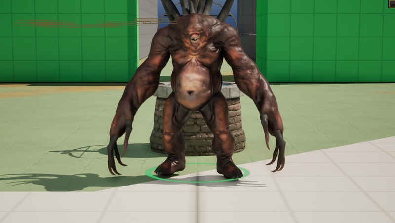
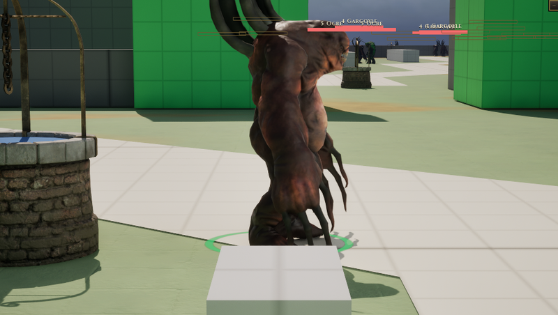

# Gargoyle

[Bestiary](README.md)

**Flavour.** You are a ton of carved stone that is either perfectly still or falling on someone, and everything you touch ends up as still as you are.

 

## Clips its body plays

| Use | Clip | Seconds |
|---|---|---|
| idle | `Anim_Rock_Idle` | 3.30 |
| walk | `Anim_Rock_Walk` | 1.30 |
| run | `Anim_Rock_Run` | 0.73 |
| hit | `Anim_Rock_GetHit` | 1.23 |
| death | `Anim_Rock_Death` | 3.30 |
| attack light | `Anim_Rock_Attack_1` | 3.17 |
| attack heavy | `Anim_Rock_Attack_2` | 2.73 |
| attack alt | `AS_Gargoyle_AttackAlt` | 3.30 |
| cast | `Anim_Rock_Shout` | 3.30 |
| roar | `Anim_Rock_Shout` | 3.30 |
| dash | `Anim_Rock_Jump` | 3.30 |

Its skeleton carries 11 clips in all (`Data/Authoring/Souls/body-clips.json`); the table lists the ones the soul names.

<!-- drops: written by scripts/gen_monster_catalogue.py from the data; edit the data, not this block -->
## What it drops

A kill at a time, by the zone it stands in; how to read it, and the odds zone by zone, are on the [bestiary index](README.md#what-drops). Every number is a placeholder, worked out from the tables the game reads.

| Monster | Zone | Class | Gems | Gem tier | Rarity | Colour | Bench items | Soul |
|---|---|---|---|---|---|---|---|---|
| Gargoyle (`DA_Monster_Gargoyle`) | Beach | Normal | 40 %, 0.40 a kill | I 100 % | Normal 60 %, Magic 30 %, Rare 10 % | Red 31.7 %, Blue 31.7 %, Green 31.7 %, Iridescent 5 % | Etching Needle 2 % Expanding Lattice 3 % Polishing Wheel 1.5 % | 20 % a Gargoyle fragment; 3 make a soul (about 15 kills) |
| Gargoyle (`DA_Monster_Gargoyle`) | Fields | Normal | 40 %, 0.40 a kill | II 80 %, I 20 % | Normal 60 %, Magic 30 %, Rare 10 % | Red 31.7 %, Blue 31.7 %, Green 31.7 %, Iridescent 5 % | Etching Needle 2 % Expanding Lattice 3 % Polishing Wheel 1.5 % | 20 % a Gargoyle fragment; 3 make a soul (about 15 kills) |
| Gargoyle Sentinel (`DA_Monster_Gargoyle_Elite`) | Fields | Elite | certain, 1.40 a kill | III 80 %, II 20 % | Normal 25 %, Magic 50 %, Rare 25 % | Red 31.7 %, Blue 31.7 %, Green 31.7 %, Iridescent 5 % | Etching Needle 15 % Expanding Lattice 20 % Polishing Wheel 10 % | 100 % a Gargoyle fragment; 3 make a soul (about 3 kills) |
<!-- drops end -->

Design sheet: `docs/design/souls/gargoyle.md` in the repository. Mesh `SK_Rock`.

Pictures are frames from a game rendered off screen on 2026-10-28, the body standing idle in the town (grey-box map), HUD cropped away. Clip lengths are seconds at play rate 1, read from the clip assets (`Data/Authoring/Souls/clips.json` and `body-clips.json` for the souls).
