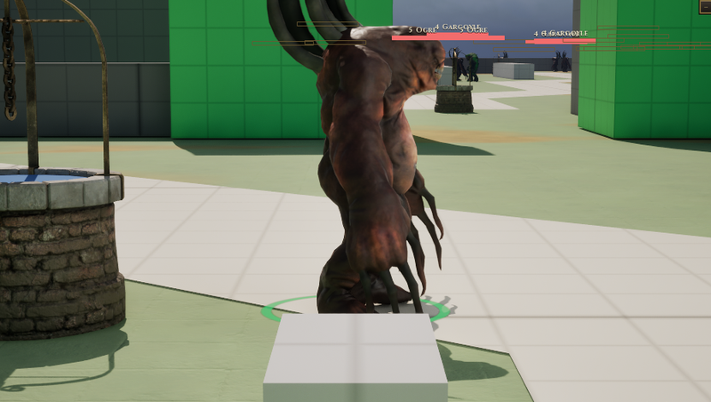

# Gargoyle

[Bestiary](README.md)

**Flavour.** You are a ton of carved stone that is either perfectly still or falling on someone, and everything you touch ends up as still as you are.

 

## Clips its body plays

| Use | Clip | Seconds |
|---|---|---|
| idle | `Anim_Rock_Idle` | 3.30 |
| walk | `Anim_Rock_Walk` | 1.30 |
| run | `Anim_Rock_Run` | 0.73 |
| hit | `Anim_Rock_GetHit` | 1.23 |
| death | `Anim_Rock_Death` | 3.30 |
| attack light | `Anim_Rock_Attack_1` | 3.17 |
| attack heavy | `Anim_Rock_Attack_2` | 2.73 |
| attack alt | `AS_Gargoyle_AttackAlt` | 3.30 |
| cast | `Anim_Rock_Shout` | 3.30 |
| roar | `Anim_Rock_Shout` | 3.30 |
| dash | `Anim_Rock_Jump` | 3.30 |

Its skeleton carries 11 clips in all (`Data/Authoring/Souls/body-clips.json`); the table lists the ones the soul names.

Design sheet: `docs/design/souls/gargoyle.md` in the repository. Mesh `SK_Rock`.

Pictures are frames from a game rendered off screen on 2026-10-28, the body standing idle in the town (grey-box map), HUD cropped away. Clip lengths are seconds at play rate 1, read from the clip assets (`Data/Authoring/Souls/clips.json` and `body-clips.json` for the souls).
