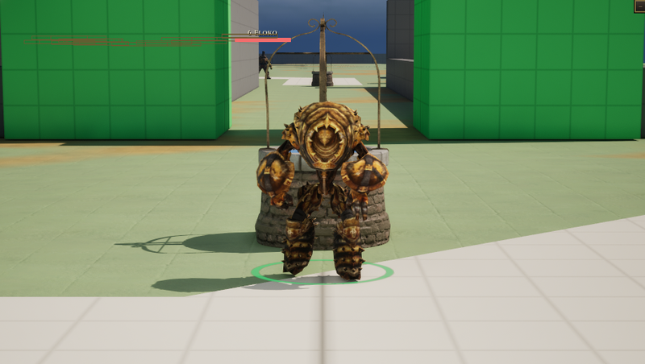
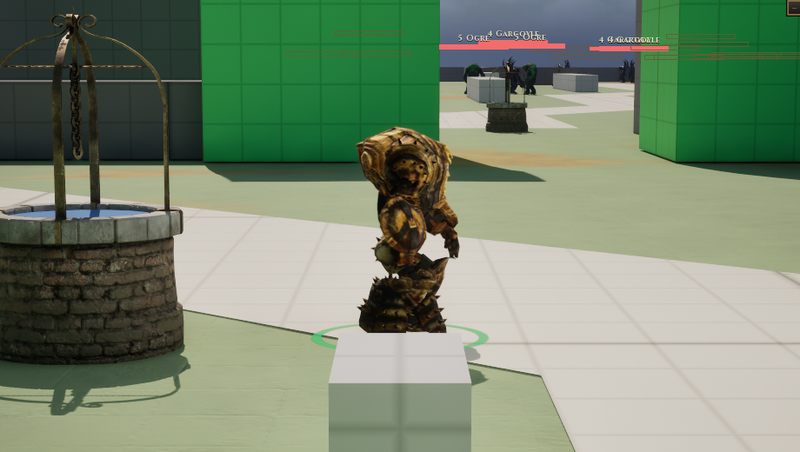

# Golem

[Bestiary](README.md)

**Flavour.** You are the slowest thing on the field and the only thing on it that does not move when hit: the ground breaks where you say, and whatever strikes you regrets it.

 

## Clips its body plays

| Use | Clip | Seconds |
|---|---|---|
| idle | `ExoGame_Fire_Golem_Idle` | 4.47 |
| walk | `AS_Golem_Walk` | 1.30 |
| run | `AS_Golem_Walk` | 1.30 |
| hit | `AS_Golem_Hit` | 1.17 |
| death | `ExoGame_Fire_Golem_Death_A` | 3.43 |
| attack light | `ExoGame_Fire_Golem_Attack_MeleeB` | 2.50 |
| attack heavy | `ExoGame_Fire_Golem_Attack_Melee` | 2.67 |
| attack alt | `ExoGame_Fire_Golem_Attack_MeleeC` | 2.17 |
| cast | `ExoGame_Fire_Golem_Aggro` | 2.33 |
| roar | `ExoGame_Fire_Golem_Aggro` | 2.33 |
| dash | `ExoGame_Fire_Golem_Ball_JumpSmash` | 1.67 |

Its skeleton carries 34 clips in all (`Data/Authoring/Souls/body-clips.json`); the table lists the ones the soul names.

<!-- drops: written by scripts/gen_monster_catalogue.py from the data; edit the data, not this block -->
## What it drops

A kill at a time, by the zone it stands in; how to read it, and the odds zone by zone, are on the [bestiary index](README.md#what-drops). Every number is a placeholder, worked out from the tables the game reads.

| Monster | Zone | Class | Gems | Gem tier | Rarity | Colour | Bench items | Soul |
|---|---|---|---|---|---|---|---|---|
| Golem (`DA_Monster_Golem`) | Pass | Normal | 40 %, 0.40 a kill | IV 80 %, III 20 % | Normal 60 %, Magic 30 %, Rare 10 % | Red 31.7 %, Blue 31.7 %, Green 31.7 %, Iridescent 5 % | Etching Needle 2 % Expanding Lattice 3 % Polishing Wheel 1.5 % | 20 % a Golem fragment; 3 make a soul (about 15 kills) |
| Golem Warden (`DA_Monster_Golem_Elite`) | Pass | Elite | certain, 1.40 a kill | V 80 %, IV 20 % | Normal 25 %, Magic 50 %, Rare 25 % | Red 31.7 %, Blue 31.7 %, Green 31.7 %, Iridescent 5 % | Etching Needle 15 % Expanding Lattice 20 % Polishing Wheel 10 % | 100 % a Golem fragment; 3 make a soul (about 3 kills) |
<!-- drops end -->

Design sheet: `docs/design/souls/golem.md` in the repository. Mesh `SK_Fire_Golem`.

Pictures are frames from a game rendered off screen on 2026-10-28, the body standing idle in the town (grey-box map), HUD cropped away. Clip lengths are seconds at play rate 1, read from the clip assets (`Data/Authoring/Souls/clips.json` and `body-clips.json` for the souls).
