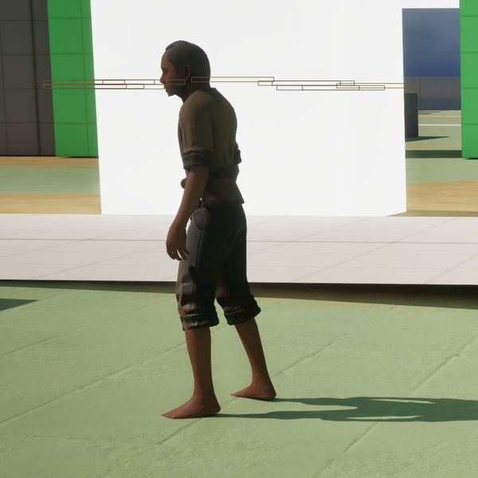

# Jorge

[Bestiary](README.md)

**Flavour.** Flavour: not written yet.

 

He is a placed body and the camera follows the player, so his front view was framed from the town arrival spot at a distance and his side view with the player walked beside him, out of the picture.

## Clips its body plays

| Use | Clip | Seconds |
|---|---|---|
| idle | `AS_Human_Idle` | 7.57 |

Jorge is `DA_Body_Jorge`, the townsperson standing in the town (CT-2.14). He is a placed body: he plays his idle and nothing else. His body names the same six clips as Walter's, which nothing plays on him today.

Pictures are frames from a game rendered off screen on 2026-10-28, the body standing idle in the town (grey-box map), HUD cropped away. Clip lengths are seconds at play rate 1, read from the clip assets (`Data/Authoring/Souls/clips.json` and `body-clips.json` for the souls).
