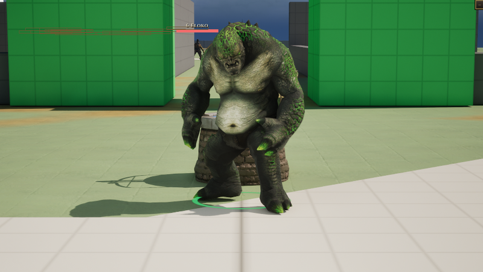
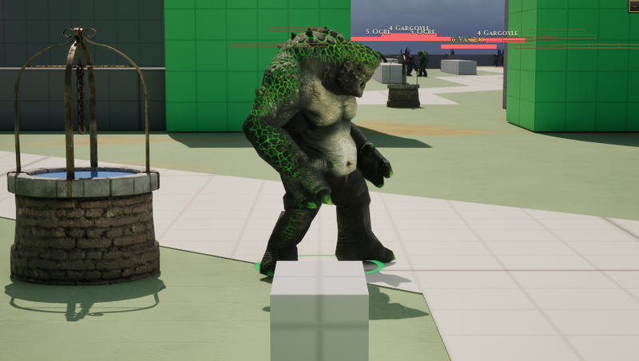

# Ogre

[Bestiary](README.md)

**Flavour.** You are the biggest thing in the room: every swing takes a second to arrive, nothing that hits you during it matters, and anything small enough goes in your mouth.

 

## Clips its body plays

| Use | Clip | Seconds |
|---|---|---|
| idle | `ExoGame_Troll_Idle_New` | 2.20 |
| walk | `ExoGame_Troll_Walk_Fwd` | 1.60 |
| run | `ExoGame_Troll_Walk_Fwd` | 1.60 |
| hit | `ExoGame_Troll_Hit_React` | 1.23 |
| death | `ExoGame_Troll_Death_` | 3.07 |
| attack light | `AS_Ogre_AttackLight` | 2.47 |
| attack heavy | `AS_Ogre_AttackHeavy` | 2.97 |
| attack alt | `ExoGame_Troll_Attack` | 1.93 |
| cast | `ExoGame_Troll_Attack_Vomit` | 4.80 |
| roar | `ExoGame_Troll_Aggro` | 2.60 |
| dash | `ExoGame_Troll_Attack_Charge` | 2.60 |

Its skeleton carries 29 clips in all (`Data/Authoring/Souls/body-clips.json`); the table lists the ones the soul names.

<!-- drops: written by scripts/gen_monster_catalogue.py from the data; edit the data, not this block -->
## What it drops

A kill at a time, by the zone it stands in; how to read it, and the odds zone by zone, are on the [bestiary index](README.md#what-drops). Every number is a placeholder, worked out from the tables the game reads.

| Monster | Zone | Class | Gems | Gem tier | Rarity | Colour | Bench items | Soul |
|---|---|---|---|---|---|---|---|---|
| Ogre (`DA_Monster_Ogre`) | Beach | Normal | 40 %, 0.40 a kill | I 100 % | Normal 60 %, Magic 30 %, Rare 10 % | Red 31.7 %, Blue 31.7 %, Green 31.7 %, Iridescent 5 % | Etching Needle 2 % Expanding Lattice 3 % Polishing Wheel 1.5 % | 20 % a Ogre fragment; 3 make a soul (about 15 kills) |
| Ogre Brute (`DA_Monster_Ogre_Elite`) | Beach | Elite | certain, 1.40 a kill | II 100 % | Normal 25 %, Magic 50 %, Rare 25 % | Red 31.7 %, Blue 31.7 %, Green 31.7 %, Iridescent 5 % | Etching Needle 15 % Expanding Lattice 20 % Polishing Wheel 10 % | 100 % a Ogre fragment; 3 make a soul (about 3 kills) |
| Ogre (`DA_Monster_Ogre`) | Fields | Normal | 40 %, 0.40 a kill | II 80 %, I 20 % | Normal 60 %, Magic 30 %, Rare 10 % | Red 31.7 %, Blue 31.7 %, Green 31.7 %, Iridescent 5 % | Etching Needle 2 % Expanding Lattice 3 % Polishing Wheel 1.5 % | 20 % a Ogre fragment; 3 make a soul (about 15 kills) |
| Ogre Brute (`DA_Monster_Ogre_Elite`) | Fields | Elite | certain, 1.40 a kill | III 80 %, II 20 % | Normal 25 %, Magic 50 %, Rare 25 % | Red 31.7 %, Blue 31.7 %, Green 31.7 %, Iridescent 5 % | Etching Needle 15 % Expanding Lattice 20 % Polishing Wheel 10 % | 100 % a Ogre fragment; 3 make a soul (about 3 kills) |
<!-- drops end -->

Design sheet: `docs/design/souls/ogre.md` in the repository. Mesh `SK_Troll_Poison`.

Pictures are frames from a game rendered off screen on 2026-10-28, the body standing idle in the town (grey-box map), HUD cropped away. Clip lengths are seconds at play rate 1, read from the clip assets (`Data/Authoring/Souls/clips.json` and `body-clips.json` for the souls).
