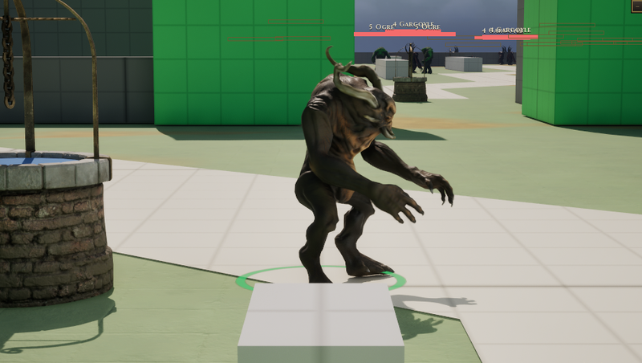

# Oni

[Bestiary](README.md)

**Flavour.** You are the masked demon that comes down the mountain faster than anything that size should, a kanabo in one fist and weather in the other, and the longer you keep swinging the worse it gets for everyone nearby, you included.

 

## Clips its body plays

| Use | Clip | Seconds |
|---|---|---|
| idle | `Anim_Horned_Idle` | 6.10 |
| walk | `Anim_Horned_Walk` | 1.17 |
| run | `Anim_Horned_Run` | 0.87 |
| hit | `Anim_Horned_GetHit` | 0.77 |
| death | `Anim_Horned_Death` | 0.83 |
| attack light | `Anim_Horned_Attack_2` | 2.73 |
| attack heavy | `Anim_Horned_Attack_1` | 2.63 |
| attack alt | `AS_Oni_AttackAlt` | 3.63 |
| cast | `Anim_Horned_Shout` | 4.30 |
| roar | `Anim_Horned_Shout` | 4.30 |
| dash | `Anim_Horned_Jump` | 2.17 |

Its skeleton carries 11 clips in all (`Data/Authoring/Souls/body-clips.json`); the table lists the ones the soul names.

Design sheet: `docs/design/souls/oni.md` in the repository. Mesh `SK_Horned`.

Pictures are frames from a game rendered off screen on 2026-10-28, the body standing idle in the town (grey-box map), HUD cropped away. Clip lengths are seconds at play rate 1, read from the clip assets (`Data/Authoring/Souls/clips.json` and `body-clips.json` for the souls).
