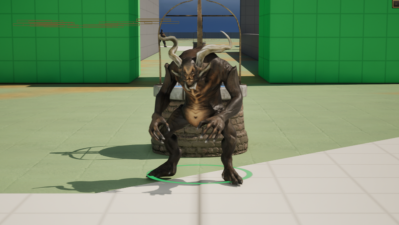
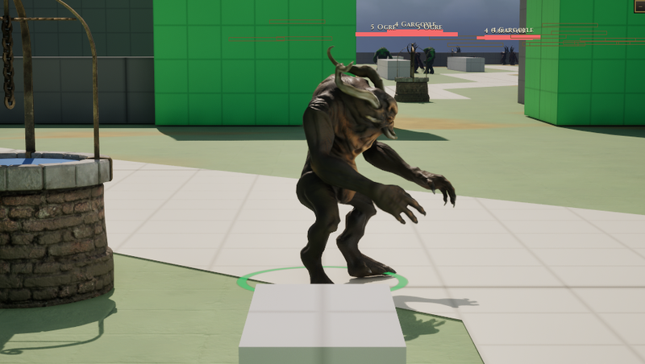

# Oni

[Bestiary](README.md)

**Flavour.** You are the masked demon that comes down the mountain faster than anything that size should, a kanabo in one fist and weather in the other, and the longer you keep swinging the worse it gets for everyone nearby, you included.

 

## Clips its body plays

| Use | Clip | Seconds |
|---|---|---|
| idle | `Anim_Horned_Idle` | 6.10 |
| walk | `Anim_Horned_Walk` | 1.17 |
| run | `Anim_Horned_Run` | 0.87 |
| hit | `Anim_Horned_GetHit` | 0.77 |
| death | `Anim_Horned_Death` | 0.83 |
| attack light | `Anim_Horned_Attack_2` | 2.73 |
| attack heavy | `Anim_Horned_Attack_1` | 2.63 |
| attack alt | `AS_Oni_AttackAlt` | 3.63 |
| cast | `Anim_Horned_Shout` | 4.30 |
| roar | `Anim_Horned_Shout` | 4.30 |
| dash | `Anim_Horned_Jump` | 2.17 |

Its skeleton carries 11 clips in all (`Data/Authoring/Souls/body-clips.json`); the table lists the ones the soul names.

<!-- drops: written by scripts/gen_monster_catalogue.py from the data; edit the data, not this block -->
## What it drops

A kill at a time, by the zone it stands in; how to read it, and the odds zone by zone, are on the [bestiary index](README.md#what-drops). Every number is a placeholder, worked out from the tables the game reads.

| Monster | Zone | Class | Gems | Gem tier | Rarity | Colour | Bench items | Soul |
|---|---|---|---|---|---|---|---|---|
| Oni (`DA_Monster_Oni`) | Pass | Normal | 40 %, 0.40 a kill | IV 80 %, III 20 % | Normal 60 %, Magic 30 %, Rare 10 % | Red 31.7 %, Blue 31.7 %, Green 31.7 %, Iridescent 5 % | Etching Needle 2 % Expanding Lattice 3 % Polishing Wheel 1.5 % | 20 % a Oni fragment; 3 make a soul (about 15 kills) |
| Oni Warlord (`DA_Monster_Oni_Elite`) | Pass | Elite | certain, 1.40 a kill | V 80 %, IV 20 % | Normal 25 %, Magic 50 %, Rare 25 % | Red 31.7 %, Blue 31.7 %, Green 31.7 %, Iridescent 5 % | Etching Needle 15 % Expanding Lattice 20 % Polishing Wheel 10 % | 100 % a Oni fragment; 3 make a soul (about 3 kills) |
<!-- drops end -->

Design sheet: `docs/design/souls/oni.md` in the repository. Mesh `SK_Horned`.

Pictures are frames from a game rendered off screen on 2026-10-28, the body standing idle in the town (grey-box map), HUD cropped away. Clip lengths are seconds at play rate 1, read from the clip assets (`Data/Authoring/Souls/clips.json` and `body-clips.json` for the souls).
