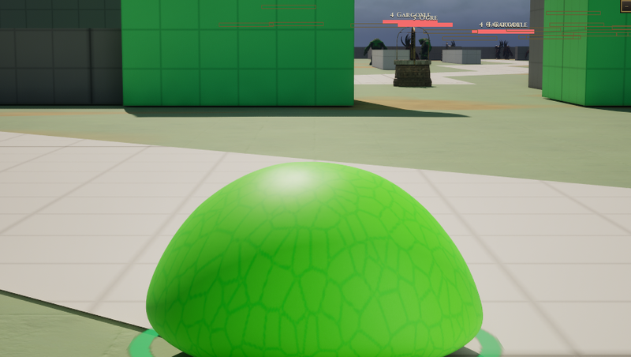

# Slime

[Bestiary](README.md)

**Flavour.** Flavour: not written yet.

 

## Clips its body plays

| Use | Clip | Seconds |
|---|---|---|
| idle | `AS_Slime_Idle` | 11.46 |
| walk | `AS_Slime_Scoot_Move` | 0.63 |
| run | `AS_Slime_Jump_Move` | 1.00 |
| dash | `AS_Slime_Jump_Move` | 1.00 |
| hit | `AS_Slime_Wiggle` | 0.83 |
| death | `AS_Slime_Squish_Start` | 1.21 |
| Tackle | `AS_Slime_Jump_Move` | 1.00 |

The body is `DA_Body_Slime` (McSteeg's "Slime Character", CT-2.65), worn by a player with no soul. The pack also holds `AS_Slime_Idle_break` (3.75), `AS_Slime_Squish_End` (1.54) and three emotes (Anger 0.67, Excite 1.04, Sad 1.50), which no body plays. The Tackle (E-2.260, `DA_Soul_Slime`, the slime's one attack) plays the hop at rate 1.5, so it lasts 0.67 s in the game.

Pictures are frames from a game rendered off screen on 2026-10-28, the body standing idle in the town (grey-box map), HUD cropped away. Clip lengths are seconds at play rate 1, read from the clip assets (`Data/Authoring/Souls/clips.json` and `body-clips.json` for the souls).
