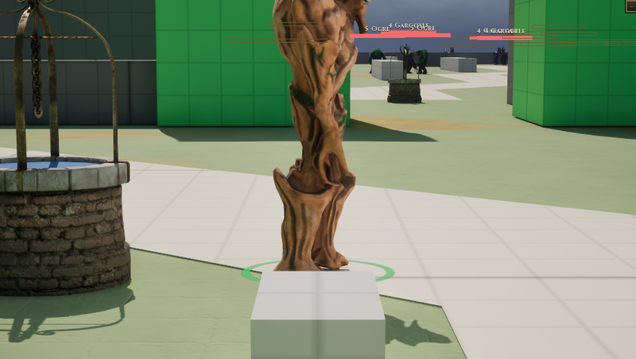

# Treant

[Bestiary](README.md)

**Flavour.** You are a walking grove: slow, enormous and never in a hurry, because the ground under the fight belongs to you, and everything that grows there answers when you call.

 

## Clips its body plays

| Use | Clip | Seconds |
|---|---|---|
| idle | `AS_Treant2_Idle` | 1.67 |
| walk | `AS_Treant2_Walk_Aligned` | 2.80 |
| run | `AS_Treant2_Run` | 1.67 |
| hit | `AS_Treant2_HitReact` | 2.00 |
| death | `AS_Treant2_Death1` | 1.25 |
| attack light | `AS_Treant2_Attack1` | 1.67 |
| attack heavy | `AS_Treant2_Attack2` | 1.04 |
| attack alt | `AS_Treant2_Attack3` | 1.25 |
| cast | `AS_Treant2_Taunt` | 2.08 |
| roar | `AS_Treant2_Taunt` | 2.08 |
| dash | `AS_Treant2_Run` | 1.67 |

Note on the body: SK_Treant_2 is 478 uu tall (CT-2.47); at scale 0.6 that is 287, so half-height 143. Yaw -90 is the class default, unseen.

Its skeleton carries 12 clips in all (`Data/Authoring/Souls/body-clips.json`); the table lists the ones the soul names.

Design sheet: `docs/design/souls/treant.md` in the repository. Mesh `SK_Treant_2`.

Pictures are frames from a game rendered off screen on 2026-10-28, the body standing idle in the town (grey-box map), HUD cropped away. Clip lengths are seconds at play rate 1, read from the clip assets (`Data/Authoring/Souls/clips.json` and `body-clips.json` for the souls).
