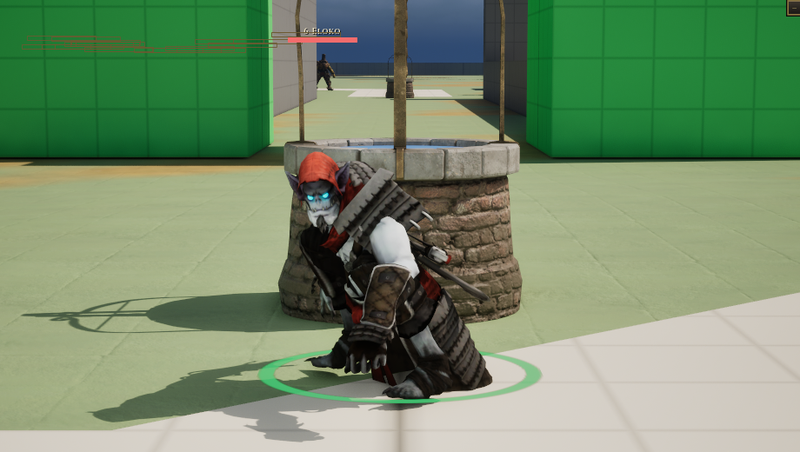
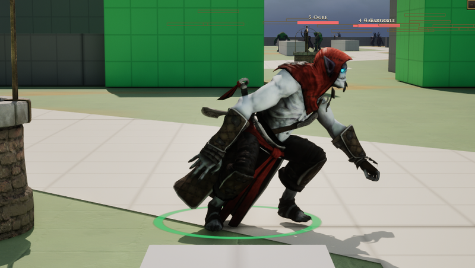

# Vampire

[Bestiary](README.md)

**Flavour.** You are a patient, well-dressed predator for whom every enemy's health bar is a glass someone else is holding for you, and your own is a debt you enjoy running up.

 

## Clips its body plays

| Use | Clip | Seconds |
|---|---|---|
| idle | `AS_Vampire_Idle` | 5.50 |
| walk | `AS_Vampire_Walk_InPlace` | 1.03 |
| run | `AS_Vampire_Run_InPlace` | 0.63 |
| hit | `AS_Vampire_HitReact` | 2.00 |
| death | `AS_Vampire_Death` | 3.60 |
| attack light | `AS_Vampire_Basic` | 1.00 |
| attack heavy | `AS_Vampire_Bloodletting` | 2.63 |
| attack alt | `AS_Vampire_VeilOfNight` | 4.27 |
| cast | `AS_Vampire_BatSwarm` | 2.70 |
| roar | `AS_Vampire_Hunger` | 2.77 |
| dash | `AS_Vampire_Run` | 0.63 |

Note on the body: Walk and Run were not downloaded In Place (CT-2.47); walk and run name the copies scripts/editor/bake_in_place_clips.py makes (hip drift removed, sway and bob kept). dash keeps AS_Vampire_Run under its root lock.

Its skeleton carries 14 clips in all (`Data/Authoring/Souls/body-clips.json`); the table lists the ones the soul names.

<!-- drops: written by scripts/gen_monster_catalogue.py from the data; edit the data, not this block -->
## What it drops

A kill at a time, by the zone it stands in; how to read it, and the odds zone by zone, are on the [bestiary index](README.md#what-drops). Every number is a placeholder, worked out from the tables the game reads.

| Monster | Zone | Class | Gems | Gem tier | Rarity | Colour | Bench items | Soul |
|---|---|---|---|---|---|---|---|---|
| Vampire (`DA_Monster_Vampire`) | Jungle | Normal | 40 %, 0.40 a kill | III 80 %, II 20 % | Normal 60 %, Magic 30 %, Rare 10 % | Red 31.7 %, Blue 31.7 %, Green 31.7 %, Iridescent 5 % | Etching Needle 2 % Expanding Lattice 3 % Polishing Wheel 1.5 % | 20 % a Vampire fragment; 3 make a soul (about 15 kills) |
| Vampire Elder (`DA_Monster_Vampire_Elite`) | Jungle | Elite | certain, 1.40 a kill | IV 80 %, III 20 % | Normal 25 %, Magic 50 %, Rare 25 % | Red 31.7 %, Blue 31.7 %, Green 31.7 %, Iridescent 5 % | Etching Needle 15 % Expanding Lattice 20 % Polishing Wheel 10 % | 100 % a Vampire fragment; 3 make a soul (about 3 kills) |
| Vampire (`DA_Monster_Vampire`) | Fields | Normal | 40 %, 0.40 a kill | II 80 %, I 20 % | Normal 60 %, Magic 30 %, Rare 10 % | Red 31.7 %, Blue 31.7 %, Green 31.7 %, Iridescent 5 % | Etching Needle 2 % Expanding Lattice 3 % Polishing Wheel 1.5 % | 20 % a Vampire fragment; 3 make a soul (about 15 kills) |
| Vampire Elder (`DA_Monster_Vampire_Elite`) | Fields | Elite | certain, 1.40 a kill | III 80 %, II 20 % | Normal 25 %, Magic 50 %, Rare 25 % | Red 31.7 %, Blue 31.7 %, Green 31.7 %, Iridescent 5 % | Etching Needle 15 % Expanding Lattice 20 % Polishing Wheel 10 % | 100 % a Vampire fragment; 3 make a soul (about 3 kills) |
<!-- drops end -->

Design sheet: `docs/design/souls/vampire.md` in the repository. Mesh `SK_Vampire`.

Pictures are frames from a game rendered off screen on 2026-10-28, the body standing idle in the town (grey-box map), HUD cropped away. Clip lengths are seconds at play rate 1, read from the clip assets (`Data/Authoring/Souls/clips.json` and `body-clips.json` for the souls).
