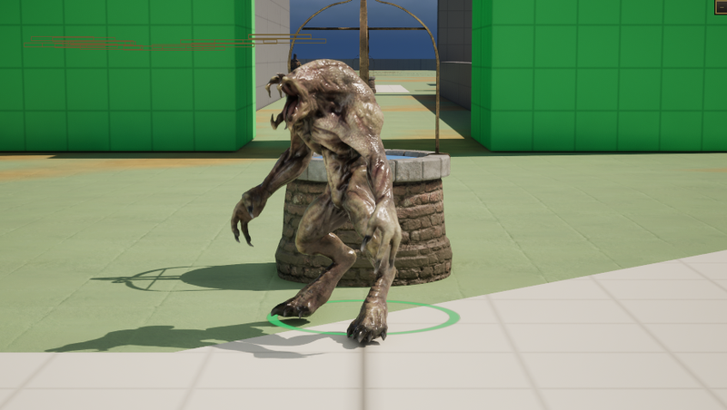
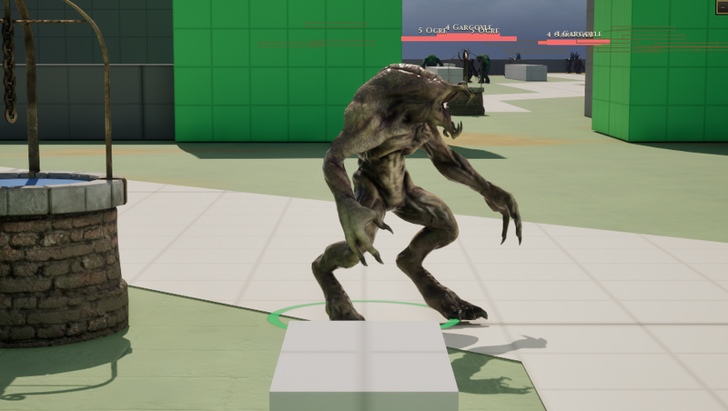

# Vetala

[Bestiary](README.md)

**Flavour.** You are not the body, you are the thing riding it: a gaunt bat-winged spirit that hangs upside down, asks questions nobody survives, and drives each borrowed corpse until it comes apart, then takes the next.

 

## Clips its body plays

| Use | Clip | Seconds |
|---|---|---|
| idle | `Anim_Devourer_Idle` | 7.83 |
| walk | `AS_Vetala_Walk` | 1.20 |
| run | `AS_Vetala_Run` | 0.87 |
| hit | `Anim_Devourer_GetHit` | 0.97 |
| death | `Anim_Devourer_Death` | 1.33 |
| attack light | `Anim_Devourer_Attack_1` | 2.67 |
| attack heavy | `Anim_Devourer_Attack_2` | 3.50 |
| attack alt | `AS_Vetala_AttackAlt` | 3.63 |
| cast | `Anim_Devourer_Shout` | 2.37 |
| roar | `Anim_Devourer_Shout` | 2.37 |
| dash | `Anim_Devourer_Jump` | 1.90 |

Its skeleton carries 11 clips in all (`Data/Authoring/Souls/body-clips.json`); the table lists the ones the soul names.

<!-- drops: written by scripts/gen_monster_catalogue.py from the data; edit the data, not this block -->
## What it drops

A kill at a time, by the zone it stands in; how to read it, and the odds zone by zone, are on the [bestiary index](README.md#what-drops). Every number is a placeholder, worked out from the tables the game reads.

| Monster | Zone | Class | Gems | Gem tier | Rarity | Colour | Bench items | Soul |
|---|---|---|---|---|---|---|---|---|
| Vetala (`DA_Monster_Vetala`) | Jungle | Normal | 40 %, 0.40 a kill | III 80 %, II 20 % | Normal 60 %, Magic 30 %, Rare 10 % | Red 31.7 %, Blue 31.7 %, Green 31.7 %, Iridescent 5 % | Etching Needle 2 % Expanding Lattice 3 % Polishing Wheel 1.5 % | 20 % a Vetala fragment; 3 make a soul (about 15 kills) |
| Vetala (`DA_Monster_Vetala`) | Pass | Normal | 40 %, 0.40 a kill | IV 80 %, III 20 % | Normal 60 %, Magic 30 %, Rare 10 % | Red 31.7 %, Blue 31.7 %, Green 31.7 %, Iridescent 5 % | Etching Needle 2 % Expanding Lattice 3 % Polishing Wheel 1.5 % | 20 % a Vetala fragment; 3 make a soul (about 15 kills) |
<!-- drops end -->

Design sheet: `docs/design/souls/vetala.md` in the repository. Mesh `SK_Devourer`.

Pictures are frames from a game rendered off screen on 2026-10-28, the body standing idle in the town (grey-box map), HUD cropped away. Clip lengths are seconds at play rate 1, read from the clip assets (`Data/Authoring/Souls/clips.json` and `body-clips.json` for the souls).
