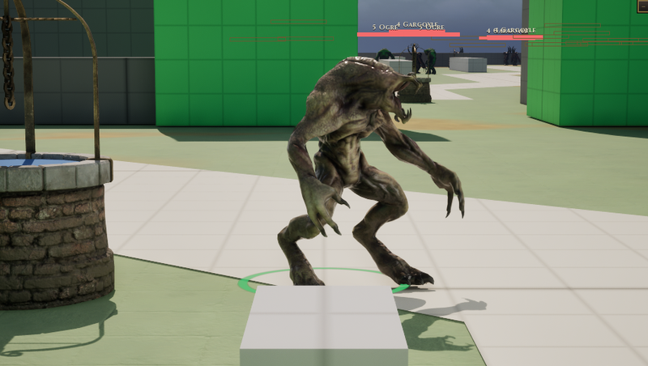

# Vetala

[Bestiary](README.md)

**Flavour.** You are not the body, you are the thing riding it: a gaunt bat-winged spirit that hangs upside down, asks questions nobody survives, and drives each borrowed corpse until it comes apart, then takes the next.

 

## Clips its body plays

| Use | Clip | Seconds |
|---|---|---|
| idle | `Anim_Devourer_Idle` | 7.83 |
| walk | `AS_Vetala_Walk` | 1.20 |
| run | `AS_Vetala_Run` | 0.87 |
| hit | `Anim_Devourer_GetHit` | 0.97 |
| death | `Anim_Devourer_Death` | 1.33 |
| attack light | `Anim_Devourer_Attack_1` | 2.67 |
| attack heavy | `Anim_Devourer_Attack_2` | 3.50 |
| attack alt | `AS_Vetala_AttackAlt` | 3.63 |
| cast | `Anim_Devourer_Shout` | 2.37 |
| roar | `Anim_Devourer_Shout` | 2.37 |
| dash | `Anim_Devourer_Jump` | 1.90 |

Its skeleton carries 11 clips in all (`Data/Authoring/Souls/body-clips.json`); the table lists the ones the soul names.

Design sheet: `docs/design/souls/vetala.md` in the repository. Mesh `SK_Devourer`.

Pictures are frames from a game rendered off screen on 2026-10-28, the body standing idle in the town (grey-box map), HUD cropped away. Clip lengths are seconds at play rate 1, read from the clip assets (`Data/Authoring/Souls/clips.json` and `body-clips.json` for the souls).
