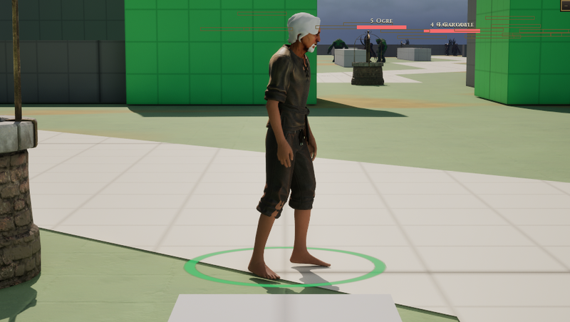

# Walter

[Bestiary](README.md)

**Flavour.** Flavour: not written yet.

 

## Clips its body plays

| Use | Clip | Seconds |
|---|---|---|
| idle | `AS_Human_Idle` | 7.57 |
| walk | `AS_Human_Walk` | 1.50 |
| run | `AS_Human_Run` | 1.77 |
| hit | `AS_Human_HitReact` | 0.70 |
| death | `AS_Human_Death` | 1.10 |
| dash | `AS_Human_Dash` | 0.97 |

Walter is `DA_Body_Human`, the MetaHuman the human soul wears (CT-2.14), and the corpse lying at the forest's start (held at the end of `AS_Human_Death`). The clips are the project's unarmed Mannequin set retargeted onto the MetaHuman skeleton.

Pictures are frames from a game rendered off screen on 2026-10-28, the body standing idle in the town (grey-box map), HUD cropped away. Clip lengths are seconds at play rate 1, read from the clip assets (`Data/Authoring/Souls/clips.json` and `body-clips.json` for the souls).
