# Monster catalogue

Every rigged body in the repository, what clips it has, and the DFMC codex line it draws on. Generated by `scripts/gen_monster_catalogue.py` from `Data/Authoring/monster-catalogue.csv`; edit the CSV, not this page. Codex art and moves are Duilio's ([creature codex](https://eccestanczyk.github.io/dfmc/creature-codex.html)); a codex match on a candidate is a seed, not a decision.

**69 bodies**: 13 in game, 56 unused. Candidates by zone: Starting Forest 3, Town 3, Zone 1 Beach 7, Zone 2 Fields 9, Zone 3 Jungle 18, Zone 4 Pass 16.

Roles: `soul` is wearable (a sheet, six abilities, a tree); `monster` is a field monster that is not a soul (a body, a kit of existing ops, a stats row); `elite` and `boss` are stages of a body; `npc` stands in the town. Clip roles are read from clip names and are a hint, not a check.

| | Body | Pack | Status | Role | Zone | Clips | Codex line | Codex art | Notes |
|---|---|---|---|---|---|---|---|---|---|
| 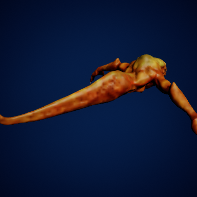 | **Creepy** `SK_Creepy` | Creatures_Pack | in game | soul | Zone 1 Beach | 8 (idle:1 walk:1 run:1 attack:3 hit:1 cast:1) |  |  | Soul since E-2.3; no death clip in the pack |
| 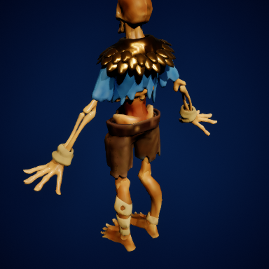 | **Corpse** `Corpse_Sword` | CityofBrass_Enemies | in game | soul | Starting Forest | 33 (idle:2 run:4 attack:11 hit:4 death:3 cast:1 move:6) |  |  | Soul since E-2.5 |
| 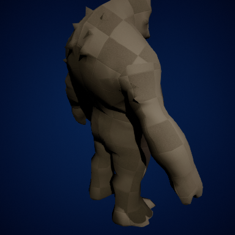 | **Ogre** `SK_Troll_Poison` | InfinityBladeAdversaries | in game | soul | Zone 2 Fields | 29 (idle:3 walk:4 attack:8 hit:9 death:2 cast:1 move:5) |  |  |  |
|  | **Oni** `SK_Horned` | Creatures_Pack | in game | soul | Zone 4 Pass | 10 (idle:1 walk:1 run:1 attack:3 hit:1 death:1 cast:1 move:1) |  |  |  |
| 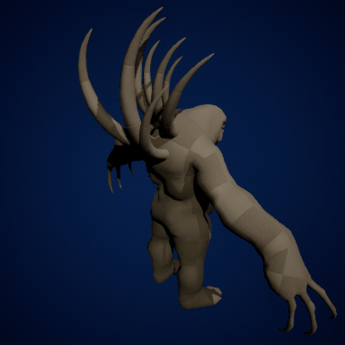 | **Gargoyle** `SK_Rock` | Creatures_Pack | in game | soul | Zone 2 Fields | 10 (idle:1 walk:1 run:1 attack:3 hit:1 death:1 cast:1 move:1) |  |  |  |
|  | **Golem** `SK_Fire_Golem` | InfinityBladeAdversaries | in game | soul | Zone 4 Pass | 33 (idle:3 walk:4 attack:7 hit:9 death:2 cast:1 move:6) |  |  | One clip for walk and run (E-2.218) |
|  | **Eloko** `SK_Master_Grunt` | InfinityBladeAdversaries | in game | soul | Zone 3 Jungle | 23 (idle:2 walk:4 attack:4 hit:7 death:1 cast:1 move:3) |  |  |  |
|  | **Treant** `SK_Treant_2` | Art | in game | soul | Zone 3 Jungle | 25 (idle:2 walk:3 run:2 attack:6 hit:2 death:6 cast:2) |  |  | CC0 Tennessippi treant; walk retargeted from Mixamo (CT-2.47) |
| 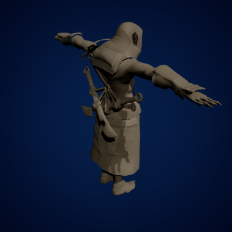 | **Vampire** `SK_Vampire` | Art | in game | soul | Zone 2 Fields | 12 (idle:1 walk:2 run:2 hit:1 death:1) |  |  | Mixamo body and clips (CT-2.47) |
|  | **Vetala** `SK_Devourer` | Creatures_Pack | in game | soul | Zone 4 Pass | 10 (idle:1 walk:1 run:1 attack:3 hit:1 death:1 cast:1 move:1) |  |  |  |
| 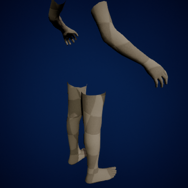 | **Walter** `DA_Body_Human` | MetaHumans | in game | npc | Town | 6 (idle:1 walk:1 run:1 hit:1 death:1 move:1) |  |  | The human soul's body (CT-2.14); clips retargeted from the Mannequin |
| 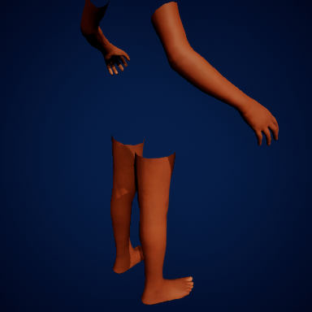 | **Jorge** `DA_Body_Jorge` | MetaHumans | in game | npc | Town | 6 (idle:1 walk:1 run:1 hit:1 death:1 move:1) |  |  | Townsperson (CT-2.14) |
| 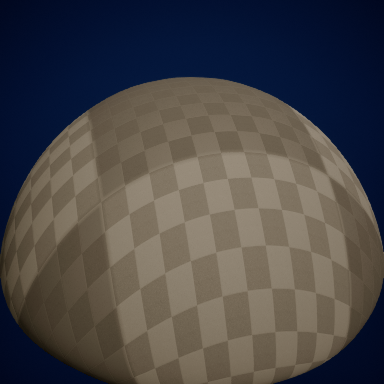 | **Slime** `SK_Slime` | Art | in game | player |  | 10 (idle:2 move:2) |  |  | The soulless player (CT-2.65) |
|  | **Alien** `SK_Alien` | Creatures_Pack | unused | candidate | Zone 3 Jungle | 10 (idle:1 walk:1 run:1 attack:3 hit:1 death:1 cast:1 move:1) | **Devout** (Insect, Swarm Thicket) Whispered Prayer/Prayer Strike/Between Blinks/Silent Grace |  | Lean humanoid insectoid; codex match is a seed for Duilio |
| 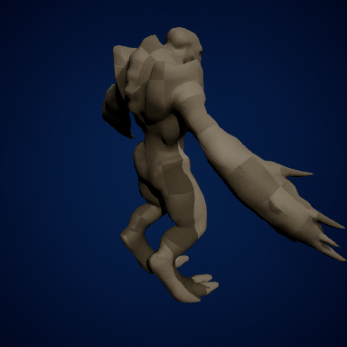 | **Bug** `SK_Bug` | Creatures_Pack | unused | candidate | Zone 3 Jungle | 10 (idle:1 walk:1 run:1 attack:3 hit:1 death:1 cast:1 move:1) | **Thornhusk** (Insect, Swarm Thicket) Husk Pop/Thorn Spray/Branch Jab/Mimic Bark |  |  |
| 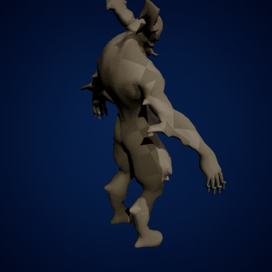 | **Daemon** `SK_Daemon` | Creatures_Pack | unused | candidate | Zone 4 Pass | 10 (idle:1 walk:1 run:1 attack:3 hit:1 death:1 cast:1 move:1) | **Nightmare** (Beast, Grasslands) Chase Down/Terror Gallop/Soul Chase/Night Veil |  |  |
| 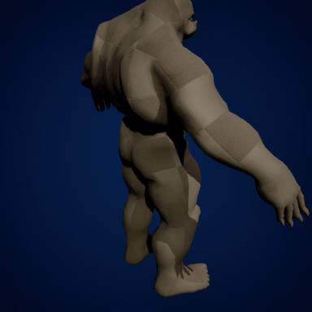 | **Exterminator** `SK_Exterminator` | Creatures_Pack | unused | candidate | Zone 3 Jungle | 10 (idle:1 walk:1 run:1 attack:3 hit:1 death:1 cast:1 move:1) | **Plaguecarrier** (Insect, Swarm Thicket) Sick Bite/Chitin Clip/Release Colony/Host's Gift |  |  |
| 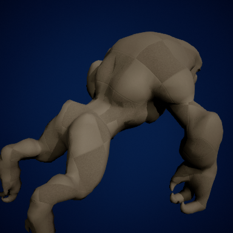 | **Hunter** `SK_Hunter` | Creatures_Pack | unused | candidate | Zone 2 Fields | 10 (idle:1 walk:1 run:1 attack:3 hit:1 death:1 cast:1 move:1) | **Dusthound** (Beast, Grasslands) Dust Cough/Run-Down/Snap/Dust Kick |  |  |
|  | **Insect** `SK_Insect` | Creatures_Pack | unused | candidate | Zone 3 Jungle | 7 (idle:1 attack:3 hit:1 death:1 move:1) | **Sporefly** (Insect, Swarm Thicket) Spore Cough/Dart/Spore Dusting/Carrier Swarm |  | Seven clips only |
| 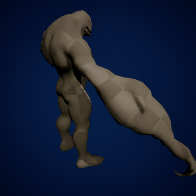 | **Mutant** `SK_Mutant` | Creatures_Pack | unused | candidate | Zone 3 Jungle | 11 (idle:1 walk:1 run:1 attack:4 hit:1 death:1 cast:1 move:1) | **Grendel** (Amphibian, Sunken Bog) Fen Blow/Marsh Maul/Parasite Shrug/Bog Lurk |  |  |
|  | **Nasty** `SK_Nasty` | Creatures_Pack | unused | candidate | Zone 3 Jungle | 11 (idle:1 walk:2 attack:3 hit:1 death:1 cast:1 move:1) | **Gloomgrub** (Insect, Swarm Thicket) Acid Spill/Acid Dribble/Corrosive Burst/Curl Up |  |  |
| 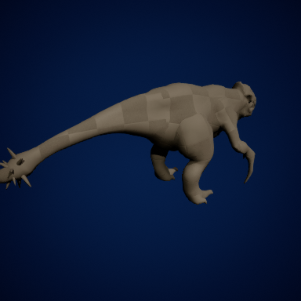 | **Pangolin** `SK_Pangolin` | Creatures_Pack | unused | candidate | Zone 4 Pass | 10 (idle:1 walk:1 run:1 attack:3 hit:1 death:1 cast:1 move:1) | **Crushmaul** (Arthropod, The Crag) Heavy Roll/Momentum Crash/Roll Over/Spikeball |  |  |
|  | **Ripper dog** `SK_Ripper_dog` | Creatures_Pack | unused | candidate | Zone 2 Fields | 10 (idle:1 walk:1 run:1 attack:3 hit:1 death:1 cast:1 move:1) | **Dusthound** (Beast, Grasslands) Dust Cough/Run-Down/Snap/Dust Kick |  | A pack animal; the Wolves below are the alternative body |
| 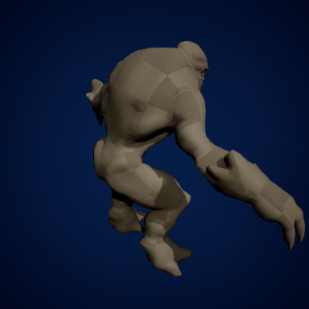 | **Shell** `SK_Shell` | Creatures_Pack | unused | candidate | Zone 1 Beach | 10 (idle:1 walk:1 run:1 attack:3 hit:1 death:1 cast:1 move:1) | **Bulwark** (Mollusk, Tidal Shallows) Shell Slam/Shell Bash/Shell Retreat/Slime Coat |  |  |
|  | **Spider** `SK_Spider` | Creatures_Pack | unused | candidate | Zone 3 Jungle | 9 (idle:1 walk:1 attack:3 hit:1 death:1 cast:1 move:1) | **Arachne** (Insect, Swarm Thicket) Silk Snip/Fang Strike/Numbing Thread/Web Corner |  | Four spider bodies in the repo; pick one line and stage them |
| 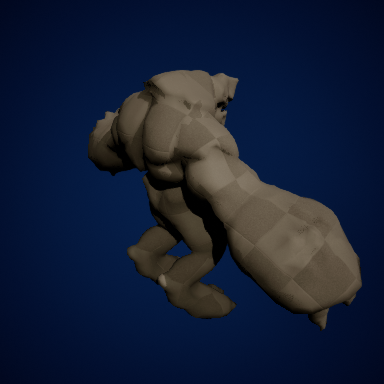 | **Titan** `SK_Titan` | Creatures_Pack | unused | candidate | Zone 4 Pass | 11 (idle:1 walk:1 run:1 attack:3 hit:1 death:1 cast:2 move:1) | **Golgoth** (Beast, Grasslands) Rock Blow/Seismic Stomp/Stone Fist/Calcify |  | Boss-sized |
|  | **Troll** `SK_Troll` | Creatures_Pack | unused | candidate | Zone 3 Jungle | 9 (idle:1 walk:1 run:1 attack:2 hit:1 death:1 cast:1 move:1) | **Grendel** (Amphibian, Sunken Bog) Fen Blow/Marsh Maul/Parasite Shrug/Bog Lurk |  |  |
|  | **Arachnid** `SK_Arachnid` | Arachnid | unused | candidate | Zone 4 Pass | 7 (idle:1 walk:1 attack:2 hit:1 death:1 cast:1) | **Voidshell** (Arthropod, The Crag) Dim Light/Absent Sting/Nullpinch/Lightless Carapace |  |  |
|  | **Elemental Robot** `SK_Elemental_Robot` | InfinityBladeAdversaries | unused | candidate | Zone 4 Pass | none in the repo | **Vigil** (Construct, Flaming Hellscape) Standing Watch/Warden Strike/Standing Order/Protocol Shield |  | No animation folder of its own in the repo; clips to find or retarget |
|  | **Elemental Boss Robot** `SK_Elemental_Boss_Robot` | InfinityBladeAdversaries | unused | candidate | Zone 4 Pass | none in the repo | **Talos** (Arthropod, The Crag) Heavy Blow/Iron Backfist/Ore-Bound Bulk/Foundry Guard |  | No animation folder of its own in the repo |
|  | **Clot Worm** `SK_Enemy_Clot_Worm` | InfinityBladeAdversaries | unused | candidate | Zone 1 Beach | 18 (idle:2 hit:5 death:1 move:2) | **Slagworm** (Ooze, The Crag) Rock Chew/Caustic Glide/Dissolve Stone/Molten Mucus |  |  |
|  | **Creature Spider** `SK_EXO_Creature_Spider02` | InfinityBladeAdversaries | unused | candidate | Zone 3 Jungle | 24 (idle:2 walk:4 attack:2 hit:6 death:2 move:6) | **Arachne** (Insect, Swarm Thicket) Silk Snip/Fang Strike/Numbing Thread/Web Corner |  |  |
|  | **Frost Giant Captain** `SK_Enemy_FrostGiant_Captain` | InfinityBladeAdversaries | unused | candidate | Zone 4 Pass | 15 (idle:1 attack:6 hit:5 cast:1 move:2) |  |  | The Jotunn draft (docs/design/souls/jotunn.md) names this body; three giants share one clip set |
|  | **Frost Giant Magic** `SK_Enemy_FrostGiant_Magic` | InfinityBladeAdversaries | unused | candidate | Zone 4 Pass | 15 (idle:1 attack:6 hit:5 cast:1 move:2) |  |  | Shares the Frost Giant clips |
|  | **Frost Giant Ranged** `SK_Enemy_FrostGiant_Ranged` | InfinityBladeAdversaries | unused | candidate | Zone 4 Pass | 15 (idle:1 attack:6 hit:5 cast:1 move:2) |  |  | Shares the Frost Giant clips |
|  | **Greater Spider** `SK_Greater_Spider` | InfinityBladeAdversaries | unused | candidate | Zone 3 Jungle | 20 (idle:2 walk:4 attack:4 hit:6 death:1 cast:2) | **Arachne** (Insect, Swarm Thicket) Silk Snip/Fang Strike/Numbing Thread/Web Corner |  | Stage 3 of a spider line |
|  | **Greater Spider Boss** `SK_Greater_Spider_Boss` | InfinityBladeAdversaries | unused | candidate | Zone 3 Jungle | 2 (move:1) | **Arachne** (Insect, Swarm Thicket) Silk Snip/Fang Strike/Numbing Thread/Web Corner |  | Two clips only; a boss body that would borrow the Greater Spider's set |
|  | **Spiderling** `SK_Spiderling` | InfinityBladeAdversaries | unused | candidate | Zone 3 Jungle | none in the repo | **Spiderling** (Insect, Swarm Thicket) Silk Snip/Fang Strike/Numbing Thread/Web Corner |  | Stage 1 of a spider line; no animation folder of its own |
| 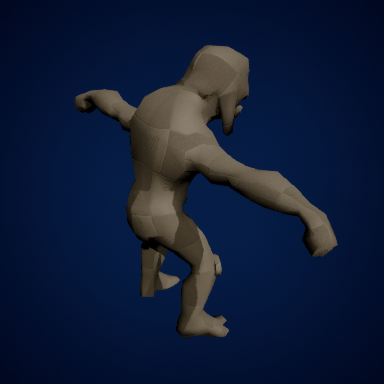 | **Gruntling** `SK_Exodus_Gruntling` | InfinityBladeAdversaries | unused | candidate | Zone 2 Fields | 28 (idle:1 walk:5 run:2 hit:7 death:7 cast:2 move:1) | **Locust** (Insect, Swarm Thicket) Swarm Gather/Swarm Surge/Strip Field/Devour |  | Five gruntling bodies share a clip set: a goblin pack with four skins |
|  | **Gruntling Avalanche** `SK_Gruntling_Avalanche` | InfinityBladeAdversaries | unused | candidate | Zone 4 Pass | 28 (idle:1 walk:5 run:2 hit:7 death:7 cast:2 move:1) |  |  | Gruntling skin |
|  | **Gruntling Glacer** `SK_Gruntling_Glacer` | InfinityBladeAdversaries | unused | candidate | Zone 4 Pass | 28 (idle:1 walk:5 run:2 hit:7 death:7 cast:2 move:1) |  |  | Gruntling skin |
|  | **Gruntling Guardian** `SK_Gruntling_Guardian` | InfinityBladeAdversaries | unused | candidate | Zone 2 Fields | 27 (idle:1 walk:5 run:2 hit:7 death:6 cast:2 move:1) |  |  | Gruntling skin |
| 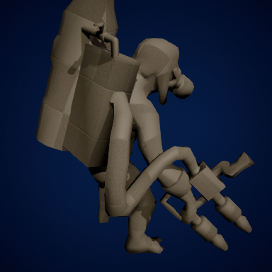 | **Gruntling Scud** `SK_Gruntling_Scud` | InfinityBladeAdversaries | unused | candidate | Zone 2 Fields | 28 (idle:1 walk:5 run:2 hit:7 death:7 cast:2 move:1) |  |  | Gruntling skin |
|  | **Robo Golem** `SK_Robo_Golem` | InfinityBladeAdversaries | unused | candidate | Zone 4 Pass | 6 (idle:2 attack:1 cast:1) | **Moloch** (Construct, Flaming Hellscape) Hungry Maw/Idol Fist/Furnace Belly/Iron Adoration |  | Six clips |
| 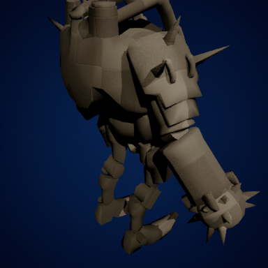 | **Robo Golem Melee** `SK_Robo_Golem_Melee` | InfinityBladeAdversaries | unused | candidate | Zone 4 Pass | 6 (idle:2 attack:1 cast:1) | **Moloch** (Construct, Flaming Hellscape) Hungry Maw/Idol Fist/Furnace Belly/Iron Adoration |  | Six clips |
| 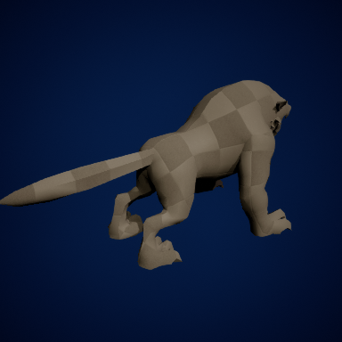 | **Wolf** `SK_Enemy_Wolf_Base` | InfinityBladeAdversaries | unused | candidate | Zone 2 Fields | 2 (idle:1 attack:1) | **Dusthound** (Beast, Grasslands) Dust Cough/Run-Down/Snap/Dust Kick |  | Two clips only; needs a retarget or the Ripper dog instead |
|  | **Armored Wolf** `SK_Enemy_Wolf_Armored` | InfinityBladeAdversaries | unused | candidate | Zone 4 Pass | 2 (idle:1 attack:1) | **Galehowl** (Avian, Storm Peaks) Wind Fang/Keening Bite/Tornado Howl/Eye of the Wind |  | Two clips only |
| 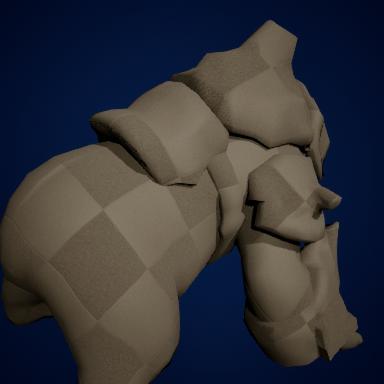 | **Bear** `Enemy_Bear` | InfinityBladeAdversaries | unused | candidate | Zone 2 Fields | 11 (idle:1 walk:2 attack:6 hit:1 death:2 move:1) | **Golgoth** (Beast, Grasslands) Rock Blow/Seismic Stomp/Stone Fist/Calcify |  | Polar and stone material instances in the pack: three bears from one body |
|  | **Forge King** `Forge_King` | InfinityBladeAdversaries | unused | candidate | Zone 4 Pass | 2 (walk:1) | **Ferrodrake** (Construct, Flaming Hellscape) Furnace Roar/Molten Rivets/Pig-Iron Bite/Foundry Hide |  | Two clips only; a boss body |
|  | **Charcharosaurus** `SK_Charcharosaurus` | SciFiCreaturesVol1 | unused | candidate | Zone 2 Fields | 33 (idle:1 walk:2 run:2 attack:19 hit:3 death:1 cast:1 move:8) | **Duskscale** (Reptile, Desert Plains) Dusk Bite/Basking Fury/Tail Sweep/Duskshift |  | 33 clips including combos and root-motion variants |
|  | **Gastarias** `SK_Gastarias` | SciFiCreaturesVol1 | unused | candidate | Zone 3 Jungle | 10 (idle:1 attack:2 hit:2 death:1) | **Vespid** (Insect, Swarm Thicket) Crown Swarm/Sting/Queen's Decree/Spore Brood |  | Gastarias > Gastarid > Gastaroid > Queen is a ready four-stage brood with an egg mesh |
| 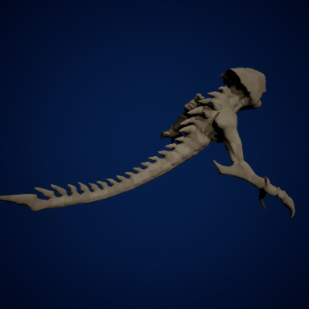 | **Gastarid** `SK_Gastarid` | SciFiCreaturesVol1 | unused | candidate | Zone 3 Jungle | 20 (idle:2 walk:2 run:2 attack:5 hit:3 death:1 cast:1 move:4) | **Cordyceps** (Insect, Swarm Thicket) Crown Swarm/Sting/Queen's Decree/Spore Brood |  | Stage 2 of the brood |
|  | **Gastaroid** `SK_Gastaroid` | SciFiCreaturesVol1 | unused | candidate | Zone 3 Jungle | 24 (idle:1 walk:2 run:2 attack:11 hit:2 death:1 cast:1 move:6) | **Vespera** (Insect, Swarm Thicket) Crown Swarm/Sting/Queen's Decree/Spore Brood |  | Stage 3 of the brood |
| 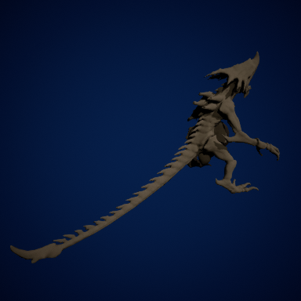 | **Gastaroid Queen** `SK_GastaroidQueen` | SciFiCreaturesVol1 | unused | candidate | Zone 3 Jungle | 28 (idle:1 walk:2 run:2 attack:15 hit:2 death:1 cast:1 move:6) | **Vespera** (Insect, Swarm Thicket) Crown Swarm/Sting/Queen's Decree/Spore Brood |  | The brood's boss |
| 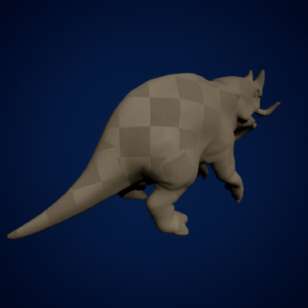 | **Hipposaurus** `SK_Hipposaurus` | SciFiCreaturesVol1 | unused | candidate | Zone 1 Beach | 29 (idle:2 walk:6 run:6 attack:2 hit:3 death:1 move:12) | **Zaratan** (Reptile, Desert Plains) Slow Roll/Weight of Ages/Ruin Shrug/Ancient Patience |  | A saddle mesh ships with it (a mount later?) |
| 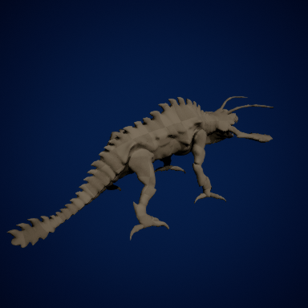 | **Lucanops** `SK_Lucanops` | SciFiCreaturesVol1 | unused | candidate | Zone 3 Jungle | 21 (idle:1 walk:6 run:6 attack:3 hit:3 death:1 cast:1 move:10) | **Thornhusk** (Insect, Swarm Thicket) Husk Pop/Thorn Spray/Branch Jab/Mimic Bark |  | Stag beetle |
|  | **Scaramar** `SK_Scaramar` | SciFiCreaturesVol1 | unused | candidate | Zone 1 Beach | 28 (idle:3 walk:2 attack:8 hit:3 death:2 move:12) | **Tidecrawler** (Aquatic, Tidal Shallows) Shell Scrape/Scuttle Strike/Pincer Snip/Shell Up |  | A spawner mesh ships with it |
|  | **Tetrapuss** `SK_Tetrapuss` | SciFiCreaturesVol1 | unused | candidate | Zone 1 Beach | 29 (idle:2 attack:3 hit:4 death:1 cast:1 move:14) | **Voidsiphon** (Mollusk, Tidal Shallows) Dark Pull/Ink Jet/Swallowing Ink/Blink Home |  |  |
|  | **Tripodonte** `SK_Tripodonte` | SciFiCreaturesVol1 | unused | candidate | Zone 1 Beach | 22 (idle:1 walk:2 run:2 attack:4 hit:2 death:1 cast:1 move:8) | **Vertigo** (Aquatic, Underwater Cave) Odd Unfold/Skitterflank/Jointed Lunge/Wrong Angles |  |  |
| 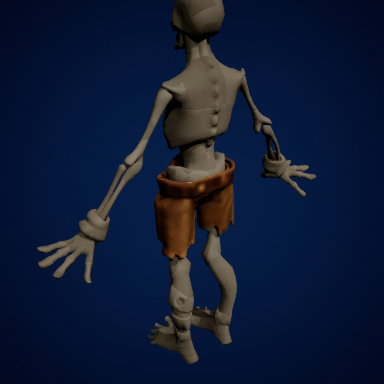 | **Corpse (basic)** `Corpse_Basic` | CityofBrass_Enemies | unused | candidate | Starting Forest | 33 (idle:2 run:4 attack:11 hit:4 death:3 cast:1 move:6) | **Garrote** (Undead, Grasslands) Tight Knot/Gallows Drop/Cinch/Wire Whip |  | Whether it shares the Corpse skeleton and clips is not verified |
|  | **Corpse (melee)** `Corpse_Melee` | CityofBrass_Enemies | unused | candidate | Starting Forest | 33 (idle:2 run:4 attack:11 hit:4 death:3 cast:1 move:6) |  |  | Skeleton sharing not verified |
| 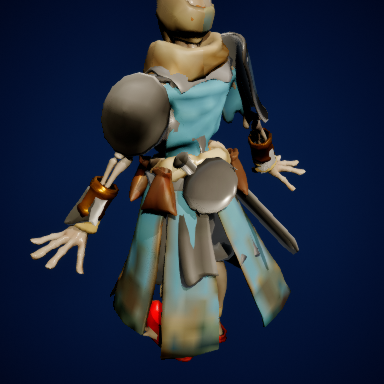 | **Corpse (spear)** `CorpseSpear_Mesh` | CityofBrass_Enemies | unused | candidate | Starting Forest | 2 (attack:2) |  |  | Two spear clips of its own; skeleton sharing not verified |
| 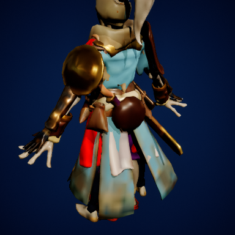 | **Archer** `Archer` | CityofBrass_Enemies | unused | candidate | Town | none in the repo |  |  | City of Brass human; no clips of its own in the repo |
|  | **Charger** `Charger` | CityofBrass_Enemies | unused | candidate | Zone 2 Fields | 13 (idle:3 walk:1 run:2 attack:13 hit:3 death:1 cast:1) | **Thornback** (Beast, Grasslands) Ram Charge/Snout Butt/Quill Flick/Bristle Up |  | Has a charge-attack and charge-wall clip set |
|  | **Grenadier** `Grenadier_Mesh` | CityofBrass_Enemies | unused | candidate | Town | 1 (attack:1) |  |  | One throw clip of its own |
| 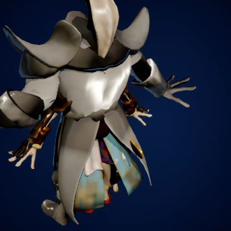 | **Hooker** `Hooker_Mesh` | CityofBrass_Enemies | unused | candidate | Zone 1 Beach | none in the repo |  |  | A boss variant mesh and a claw ship with it; no clips of its own |
|  | **Large** `Large_Mesh` | CityofBrass_Enemies | unused | candidate | Zone 4 Pass | none in the repo |  |  | Large_Charger and Large_Sword are variants; no clips of their own |
| 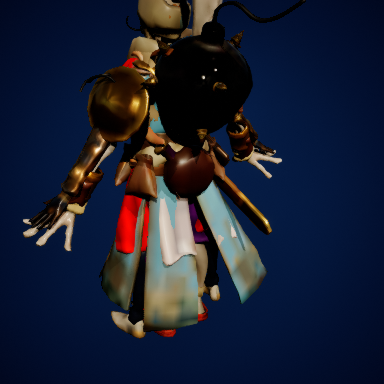 | **Sploder** `Sploder_Mesh` | CityofBrass_Enemies | unused | candidate | Zone 3 Jungle | none in the repo |  |  | No clips of its own |
|  | **Wizard** `Wizard_Mesh` | CityofBrass_Enemies | unused | candidate | Town | none in the repo |  |  | No clips of its own |

## Clip inventory

Every clip the git index holds per body folder, so a kit can name one without opening the editor.

<b>Creepy</b> — 8 clips in <code>Content/Creatures_Pack/Animations/Creature_Creepy</code>

`Anim_Creepy_Attack_1_`, `Anim_Creepy_Attack_2_`, `Anim_Creepy_Attack_3_`, `Anim_Creepy_GetHit`, `Anim_Creepy_Idle`, `Anim_Creepy_Run`, `Anim_Creepy_Shout`, `Anim_Creepy_Walk`

<b>Corpse</b> — 33 clips in <code>Content/CityofBrass_Enemies/Meshes/Enemy/Corpse/animation</code>

`Corpse_Alert_Attack_Approach`, `Corpse_Alert_Attack_Basic01`, `Corpse_Alert_Attack_Basic02`, `Corpse_Alert_Attack_Basic03`, `Corpse_Alert_Attack_Basic04`, `Corpse_Alert_Attack_Fast`, `Corpse_Alert_Attack_Fast2`, `Corpse_Alert_Attack_Push`, `Corpse_Alert_Attack_Shield_Push`, `Corpse_Alert_Attack_Slow`, `Corpse_Alert_Death`, `Corpse_Alert_Death2`, `Corpse_Alert_Death3`, `Corpse_Alert_Distracted_Grab`, `Corpse_Alert_Stun_Knock_Back`, `Corpse_Alert_Stunned`, `Corpse_Alert_Taunt`, `Corpse_Alert_Tripped`, `Corpse_Alert_Tripped_Forward`, `Corpse_Alert_turn_AddBase`, `Corpse_Alert_turn_Left_45`, `Corpse_Alert_turn_Left_90`, `Corpse_Alert_turn_Middle`, `Corpse_Alert_turn_Right_45`, `Corpse_Alert_turn_Right_90`, `Corpse_Disarm`, `Corpse_Run_Back`, `Corpse_Run_Forward`, `Corpse_Run_Left`, `Corpse_Run_Right`, `Corpse_alert_attack_right`, `Corpse_alert_idle`, `Corpse_passive_idle`

<b>Ogre</b> — 29 clips in <code>Content/InfinityBladeAdversaries/Enemy/Enemy_Troll/Enemy_Troll_Poison_Animation</code>

`ExoGame_Troll_Aggro`, `ExoGame_Troll_Attack`, `ExoGame_Troll_Attack_B`, `ExoGame_Troll_Attack_C`, `ExoGame_Troll_Attack_Charge`, `ExoGame_Troll_Attack_HandSwipe`, `ExoGame_Troll_Attack_Overhead`, `ExoGame_Troll_Attack_Vomit`, `ExoGame_Troll_Death_`, `ExoGame_Troll_Hit_React`, `ExoGame_Troll_Idle_Home`, `ExoGame_Troll_Idle_New`, `ExoGame_Troll_Intro_Drop_Down`, `ExoGame_Troll_Intro_Drop_Down_B`, `ExoGame_Troll_Intro_Drop_Down_Cinematic`, `ExoGame_Troll_React_Death`, `ExoGame_Troll_React_Heavy_Front`, `ExoGame_Troll_React_KnowckBack_Front`, `ExoGame_Troll_React_Spawn_Climb`, `ExoGame_Troll_React_Stunned`, `ExoGame_Troll_React_Stunned_Enter`, `ExoGame_Troll_React_Stunned_Exit`, `ExoGame_Troll_React_Stunned_Idle`, `ExoGame_Troll_Turn_Left`, `ExoGame_Troll_Turn_Right`, `ExoGame_Troll_Walk_Bwd_New`, `ExoGame_Troll_Walk_Fwd`, `ExoGame_Troll_Walk_Left`, `ExoGame_Troll_Walk_Right`

<b>Oni</b> — 10 clips in <code>Content/Creatures_Pack/Animations/Creature_Horned</code>

`Anim_Horned_Attack_1`, `Anim_Horned_Attack_2`, `Anim_Horned_Attack_3`, `Anim_Horned_Death`, `Anim_Horned_GetHit`, `Anim_Horned_Idle`, `Anim_Horned_Jump`, `Anim_Horned_Run`, `Anim_Horned_Shout`, `Anim_Horned_Walk`

<b>Gargoyle</b> — 10 clips in <code>Content/Creatures_Pack/Animations/Creature_Rock</code>

`Anim_Rock_Attack_1`, `Anim_Rock_Attack_2`, `Anim_Rock_Attack_3`, `Anim_Rock_Death`, `Anim_Rock_GetHit`, `Anim_Rock_Idle`, `Anim_Rock_Jump`, `Anim_Rock_Run`, `Anim_Rock_Shout`, `Anim_Rock_Walk`

<b>Golem</b> — 33 clips in <code>Content/InfinityBladeAdversaries/Enemy/Enemy_Golem/Enemy_Golem_Animations</code>

`ExoGame_Fire_Golem_Aggro`, `ExoGame_Fire_Golem_Attack_Ball_Exit`, `ExoGame_Fire_Golem_Attack_Melee`, `ExoGame_Fire_Golem_Attack_MeleeB`, `ExoGame_Fire_Golem_Attack_MeleeC`, `ExoGame_Fire_Golem_Ball_Charge`, `ExoGame_Fire_Golem_Ball_Charge_SuperFast`, `ExoGame_Fire_Golem_Ball_Enter_Jump`, `ExoGame_Fire_Golem_Ball_Enter_JumpTuck`, `ExoGame_Fire_Golem_Ball_Idle`, `ExoGame_Fire_Golem_Ball_JumpSmash`, `ExoGame_Fire_Golem_Death_A`, `ExoGame_Fire_Golem_Death_OilSpill`, `ExoGame_Fire_Golem_DormantPose`, `ExoGame_Fire_Golem_Dormant_WakeUp`, `ExoGame_Fire_Golem_DropDown`, `ExoGame_Fire_Golem_Falling`, `ExoGame_Fire_Golem_Idle`, `ExoGame_Fire_Golem_React_Heavy_Front`, `ExoGame_Fire_Golem_React_Heavy_Front_Alt`, `ExoGame_Fire_Golem_React_Knockback`, `ExoGame_Fire_Golem_React_Knockback_Alt`, `ExoGame_Fire_Golem_React_Stunned`, `ExoGame_Fire_Golem_React_Stunned_B`, `ExoGame_Fire_Golem_React_Stunned_Enter`, `ExoGame_Fire_Golem_React_Stunned_Exit`, `ExoGame_Fire_Golem_React_Stunned_Idle`, `ExoGame_Fire_Golem_TurnLeft_90`, `ExoGame_Fire_Golem_TurnRight_90`, `ExoGame_Fire_Golem_Walk_BWD`, `ExoGame_Fire_Golem_Walk_FWD`, `ExoGame_Fire_Golem_Walk_Left`, `ExoGame_Fire_Golem_Walk_Right`

<b>Eloko</b> — 23 clips in <code>Content/InfinityBladeAdversaries/Enemy/Enemy_Master_Grunt/Enemy_Master_Grunt_Animation</code>

`ExoGame_MasterGrunt_Attack_Melee`, `ExoGame_MasterGrunt_Attack_Melee_B`, `ExoGame_MasterGrunt_Attack_Melee_C`, `ExoGame_MasterGrunt_Attack_Ranged`, `ExoGame_MasterGrunt_Cast_Summon`, `ExoGame_MasterGrunt_Death`, `ExoGame_MasterGrunt_Dropdown`, `ExoGame_MasterGrunt_Idle`, `ExoGame_MasterGrunt_Intro`, `ExoGame_MasterGrunt_React_Heavy_Front`, `ExoGame_MasterGrunt_React_Knockback_Front`, `ExoGame_MasterGrunt_React_Light_Front`, `ExoGame_MasterGrunt_React_Stunned`, `ExoGame_MasterGrunt_React_Stunned_Enter`, `ExoGame_MasterGrunt_React_Stunned_Exit`, `ExoGame_MasterGrunt_React_Stunned_Idle`, `ExoGame_MasterGrunt_TurnLeft_90`, `ExoGame_MasterGrunt_TurnRight_90`, `ExoGame_MasterGrunt_Walk_Bwd`, `ExoGame_MasterGrunt_Walk_Fwd`, `ExoGame_MasterGrunt_Walk_Left`, `ExoGame_MasterGrunt_Walk_Right`, `ExoGame_MasterGrunt_Walldown_Slide`

<b>Treant</b> — 25 clips in <code>Content/Art/Characters/Treant</code>

`AS_Treant1_Attack1`, `AS_Treant1_Attack2`, `AS_Treant1_Attack3`, `AS_Treant1_Death1`, `AS_Treant1_Death2`, `AS_Treant1_Death3`, `AS_Treant1_HitReact`, `AS_Treant1_Idle`, `AS_Treant1_RiverDance`, `AS_Treant1_Run`, `AS_Treant1_Taunt`, `AS_Treant1_Walk`, `AS_Treant2_Attack1`, `AS_Treant2_Attack2`, `AS_Treant2_Attack3`, `AS_Treant2_Death1`, `AS_Treant2_Death2`, `AS_Treant2_Death3`, `AS_Treant2_HitReact`, `AS_Treant2_Idle`, `AS_Treant2_RiverDance`, `AS_Treant2_Run`, `AS_Treant2_Taunt`, `AS_Treant2_Walk`, `AS_Treant2_Walk_Aligned`

<b>Vampire</b> — 12 clips in <code>Content/Art/Characters/Vampire</code>

`AS_Vampire_Basic`, `AS_Vampire_BatSwarm`, `AS_Vampire_Bloodletting`, `AS_Vampire_Death`, `AS_Vampire_HitReact`, `AS_Vampire_Hunger`, `AS_Vampire_Idle`, `AS_Vampire_Run`, `AS_Vampire_Run_InPlace`, `AS_Vampire_VeilOfNight`, `AS_Vampire_Walk`, `AS_Vampire_Walk_InPlace`

<b>Vetala</b> — 10 clips in <code>Content/Creatures_Pack/Animations/Creature_Devourer</code>

`Anim_Devourer_Attack_1`, `Anim_Devourer_Attack_2`, `Anim_Devourer_Attack_3`, `Anim_Devourer_Death`, `Anim_Devourer_GetHit`, `Anim_Devourer_Idle`, `Anim_Devourer_Jump`, `Anim_Devourer_Run`, `Anim_Devourer_Shout`, `Anim_Devourer_Walk`

<b>Walter</b> — 6 clips in <code>Content/Art/Characters/Human</code>

`AS_Human_Dash`, `AS_Human_Death`, `AS_Human_HitReact`, `AS_Human_Idle`, `AS_Human_Run`, `AS_Human_Walk`

<b>Jorge</b> — 6 clips in <code>Content/Art/Characters/Human</code>

`AS_Human_Dash`, `AS_Human_Death`, `AS_Human_HitReact`, `AS_Human_Idle`, `AS_Human_Run`, `AS_Human_Walk`

<b>Slime</b> — 10 clips in <code>Content/Art/Characters/Slime</code>

`AS_Slime_Emote_Anger`, `AS_Slime_Emote_Excite`, `AS_Slime_Emote_Sad`, `AS_Slime_Idle`, `AS_Slime_Idle_break`, `AS_Slime_Jump_Move`, `AS_Slime_Scoot_Move`, `AS_Slime_Squish_End`, `AS_Slime_Squish_Start`, `AS_Slime_Wiggle`

<b>Alien</b> — 10 clips in <code>Content/Creatures_Pack/Animations/Creature_Alien</code>

`Anim_Alien_Attack_1`, `Anim_Alien_Attack_2`, `Anim_Alien_Attack_3`, `Anim_Alien_Death`, `Anim_Alien_GetHit`, `Anim_Alien_Idle`, `Anim_Alien_Jump`, `Anim_Alien_Run`, `Anim_Alien_Shout`, `Anim_Alien_Walk`

<b>Bug</b> — 10 clips in <code>Content/Creatures_Pack/Animations/Creature_Bug</code>

`Anim_Bug_Attack_1`, `Anim_Bug_Attack_2`, `Anim_Bug_Attack_3`, `Anim_Bug_Death`, `Anim_Bug_GetHit`, `Anim_Bug_Idle`, `Anim_Bug_Jump`, `Anim_Bug_Run`, `Anim_Bug_Shout`, `Anim_Bug_Walk`

<b>Daemon</b> — 10 clips in <code>Content/Creatures_Pack/Animations/Creature_Daemon</code>

`Anim_Daemon_Attack_1`, `Anim_Daemon_Attack_2`, `Anim_Daemon_Attack_3`, `Anim_Daemon_Death`, `Anim_Daemon_GetHit`, `Anim_Daemon_Idle`, `Anim_Daemon_Jump`, `Anim_Daemon_Run`, `Anim_Daemon_Shout`, `Anim_Daemon_Walk`

<b>Exterminator</b> — 10 clips in <code>Content/Creatures_Pack/Animations/Creature_Exterminator</code>

`Anim_Exterminator_Attack_1`, `Anim_Exterminator_Attack_2`, `Anim_Exterminator_Attack_3`, `Anim_Exterminator_Death`, `Anim_Exterminator_GetHit`, `Anim_Exterminator_Idle`, `Anim_Exterminator_Jump`, `Anim_Exterminator_Run`, `Anim_Exterminator_Shout`, `Anim_Exterminator_Walk`

<b>Hunter</b> — 10 clips in <code>Content/Creatures_Pack/Animations/Creature_Hunter</code>

`Anim_Hunter_Attack_1`, `Anim_Hunter_Attack_2`, `Anim_Hunter_Attack_3`, `Anim_Hunter_Death`, `Anim_Hunter_Get_Hit`, `Anim_Hunter_Idle`, `Anim_Hunter_Jump`, `Anim_Hunter_Run`, `Anim_Hunter_Shout`, `Anim_Hunter_Walk`

<b>Insect</b> — 7 clips in <code>Content/Creatures_Pack/Animations/Creature_Insect</code>

`Anim_Insect_Attack_1`, `Anim_Insect_Attack_2`, `Anim_Insect_Attack_3`, `Anim_Insect_Death`, `Anim_Insect_Flying`, `Anim_Insect_GetHit`, `Anim_Insect_Idle`

<b>Mutant</b> — 11 clips in <code>Content/Creatures_Pack/Animations/Creature_Mutant</code>

`Anim_Mutant_Attack_1`, `Anim_Mutant_Attack_2`, `Anim_Mutant_Attack_3`, `Anim_Mutant_Attack_4`, `Anim_Mutant_Death`, `Anim_Mutant_GetHit`, `Anim_Mutant_Idle`, `Anim_Mutant_Jump`, `Anim_Mutant_Run`, `Anim_Mutant_Shout`, `Anim_Mutant_Walk`

<b>Nasty</b> — 11 clips in <code>Content/Creatures_Pack/Animations/Creature_Nasty</code>

`Anim_Nasty_Attack_1`, `Anim_Nasty_Attack_2`, `Anim_Nasty_Attack_3`, `Anim_Nasty_Death`, `Anim_Nasty_GetHit`, `Anim_Nasty_Idle`, `Anim_Nasty_Shout`, `Anim_Nasty_Strafe`, `Anim_Nasty_Turn90`, `Anim_Nasty_Walk`, `Anim_Nasty_Walk_Fwd`

<b>Pangolin</b> — 10 clips in <code>Content/Creatures_Pack/Animations/Creature_Pangolin</code>

`Anim_Pangolin_Attack_1`, `Anim_Pangolin_Attack_2`, `Anim_Pangolin_Attack_3`, `Anim_Pangolin_Death`, `Anim_Pangolin_GetHit`, `Anim_Pangolin_Idle`, `Anim_Pangolin_Jump`, `Anim_Pangolin_Run`, `Anim_Pangolin_Shout`, `Anim_Pangolin_Walk`

<b>Ripper dog</b> — 10 clips in <code>Content/Creatures_Pack/Animations/Creature_Ripper_Dog</code>

`Anim_Ripper_dog_Attack_1`, `Anim_Ripper_dog_Attack_2`, `Anim_Ripper_dog_Attack_3`, `Anim_Ripper_dog_Death`, `Anim_Ripper_dog_GetHit`, `Anim_Ripper_dog_Idle`, `Anim_Ripper_dog_Jump`, `Anim_Ripper_dog_Run`, `Anim_Ripper_dog_Shout`, `Anim_Ripper_dog_Walk`

<b>Shell</b> — 10 clips in <code>Content/Creatures_Pack/Animations/Creature_Shell</code>

`Anim_Shell_Attack_1`, `Anim_Shell_Attack_2`, `Anim_Shell_Attack_3`, `Anim_Shell_Death`, `Anim_Shell_GetHit`, `Anim_Shell_Idle`, `Anim_Shell_Jump`, `Anim_Shell_Run`, `Anim_Shell_Shout`, `Anim_Shell_Walk`

<b>Spider</b> — 9 clips in <code>Content/Creatures_Pack/Animations/Creature_Spider</code>

`Anim_Spider_Attack_1`, `Anim_Spider_Attack_2`, `Anim_Spider_Attack_3`, `Anim_Spider_Death`, `Anim_Spider_GetHit`, `Anim_Spider_Idle`, `Anim_Spider_Jump`, `Anim_Spider_Shout`, `Anim_Spider_Walk`

<b>Titan</b> — 11 clips in <code>Content/Creatures_Pack/Animations/Creatures_Titan</code>

`Anim_Titan_Attack_1`, `Anim_Titan_Attack_2`, `Anim_Titan_Attack_3`, `Anim_Titan_Death`, `Anim_Titan_GetHit`, `Anim_Titan_Idle`, `Anim_Titan_Jump`, `Anim_Titan_Run`, `Anim_Titan_Shout`, `Anim_Titan_Shout2`, `Anim_Titan_Walk`

<b>Troll</b> — 9 clips in <code>Content/Creatures_Pack/Animations/Creature_Troll</code>

`Anim_Troll_Attack_1_`, `Anim_Troll_Attack_2_`, `Anim_Troll_Death`, `Anim_Troll_GetHit`, `Anim_Troll_Idle`, `Anim_Troll_Jump`, `Anim_Troll_Run`, `Anim_Troll_Shout`, `Anim_Troll_Walk`

<b>Arachnid</b> — 7 clips in <code>Content/Arachnid/Animations</code>

`Anim_Arachnid_Attack_1`, `Anim_Arachnid_Attack_2`, `Anim_Arachnid_Dead`, `Anim_Arachnid_Get_Hit`, `Anim_Arachnid_Idle`, `Anim_Arachnid_Shout`, `Anim_Arachnid_Walk`

<b>Clot Worm</b> — 18 clips in <code>Content/InfinityBladeAdversaries/Enemy/Enemy_Clot_Worm/Enemy_Clot_Worm_Animation</code>

`ExoGame_Baby_Clot_Worm_Idle`, `ExoGame_Baby_Clot_Worm_React_Heavy`, `ExoGame_Baby_Clot_Worm_React_Light_Front`, `ExoGame_Baby_Clot_Worm_React_Light_Front2`, `ExoGame_Baby_Clot_Worm_Slither_Backwards`, `ExoGame_Baby_Clot_Worm_Slither_Foreward`, `ExoGame_Baby_Clot_Worm_Slither_Left`, `ExoGame_Baby_Clot_Worm_Slither_Right`, `ExoGame_Clot_Worm_Death_1`, `ExoGame_Clot_Worm_Idle_1`, `ExoGame_Clot_Worm_React_Heavy_Front`, `ExoGame_Clot_Worm_React_KnockBack_Front`, `ExoGame_Clot_Worm_Slither_Backward`, `ExoGame_Clot_Worm_Slither_Foreward`, `ExoGame_Clot_Worm_Slither_Left`, `ExoGame_Clot_Worm_Slither_Right`, `ExoGame_Clot_Worm_Turn_Left90`, `ExoGame_Clot_Worm_Turn_Right90`

<b>Creature Spider</b> — 24 clips in <code>Content/InfinityBladeAdversaries/Enemy/Enemy_Creature_Spider/Enemy_CreatureSpider2_Animation</code>

`ExoGame_Spider_Attack_Melee`, `ExoGame_Spider_Ceiling_Drop_Start`, `ExoGame_Spider_Death`, `ExoGame_Spider_Death_Curled`, `ExoGame_Spider_Falling`, `ExoGame_Spider_Hatch`, `ExoGame_Spider_Idle`, `ExoGame_Spider_Intro_ClimbUp`, `ExoGame_Spider_Intro_DropDown`, `ExoGame_Spider_Intro_DropDown_B`, `ExoGame_Spider_Intro_DropDown_C`, `ExoGame_Spider_React_Heavy_Front`, `ExoGame_Spider_React_Knockback_Front`, `ExoGame_Spider_React_Light_Front`, `ExoGame_Spider_React_Stunned_Enter`, `ExoGame_Spider_React_Stunned_Exit`, `ExoGame_Spider_React_Stunned_Idle`, `ExoGame_Spider_Spit_AttackV2`, `ExoGame_Spider_TurnLeft_90`, `ExoGame_Spider_TurnRight_90`, `ExoGame_Spider_Walk`, `ExoGame_Spider_Walk_Bwd`, `ExoGame_Spider_Walk_Left`, `ExoGame_Spider_Walk_Right`

<b>Frost Giant Captain</b> — 15 clips in <code>Content/InfinityBladeAdversaries/Enemy/Enemy_Frost_Giant/Enemy_Frost_Giant_All_Animation</code>

`ExoGame_FrostGiant_Aggro`, `ExoGame_FrostGiant_Attck_Melee_A`, `ExoGame_FrostGiant_Attck_Melee_C`, `ExoGame_FrostGiant_Attck_Melee_Combo`, `ExoGame_FrostGiant_Charge_Jump`, `ExoGame_FrostGiant_Charge_Start`, `ExoGame_FrostGiant_DropDown`, `ExoGame_FrostGiant_Intro`, `ExoGame_FrostGiant_React_HeavyFront`, `ExoGame_FrostGiant_React_KnockBack_Front`, `ExoGame_FrostGiant_React_Stunned_Enter`, `ExoGame_FrostGiant_React_Stunned_Exit`, `ExoGame_FrostGiant_React_Stunned_Idle`, `ExoGame_FrostGiant_Spawn_WallUp`, `ExoGame_FrostGiant_Trap_Magic`

<b>Frost Giant Magic</b> — 15 clips in <code>Content/InfinityBladeAdversaries/Enemy/Enemy_Frost_Giant/Enemy_Frost_Giant_All_Animation</code>

`ExoGame_FrostGiant_Aggro`, `ExoGame_FrostGiant_Attck_Melee_A`, `ExoGame_FrostGiant_Attck_Melee_C`, `ExoGame_FrostGiant_Attck_Melee_Combo`, `ExoGame_FrostGiant_Charge_Jump`, `ExoGame_FrostGiant_Charge_Start`, `ExoGame_FrostGiant_DropDown`, `ExoGame_FrostGiant_Intro`, `ExoGame_FrostGiant_React_HeavyFront`, `ExoGame_FrostGiant_React_KnockBack_Front`, `ExoGame_FrostGiant_React_Stunned_Enter`, `ExoGame_FrostGiant_React_Stunned_Exit`, `ExoGame_FrostGiant_React_Stunned_Idle`, `ExoGame_FrostGiant_Spawn_WallUp`, `ExoGame_FrostGiant_Trap_Magic`

<b>Frost Giant Ranged</b> — 15 clips in <code>Content/InfinityBladeAdversaries/Enemy/Enemy_Frost_Giant/Enemy_Frost_Giant_All_Animation</code>

`ExoGame_FrostGiant_Aggro`, `ExoGame_FrostGiant_Attck_Melee_A`, `ExoGame_FrostGiant_Attck_Melee_C`, `ExoGame_FrostGiant_Attck_Melee_Combo`, `ExoGame_FrostGiant_Charge_Jump`, `ExoGame_FrostGiant_Charge_Start`, `ExoGame_FrostGiant_DropDown`, `ExoGame_FrostGiant_Intro`, `ExoGame_FrostGiant_React_HeavyFront`, `ExoGame_FrostGiant_React_KnockBack_Front`, `ExoGame_FrostGiant_React_Stunned_Enter`, `ExoGame_FrostGiant_React_Stunned_Exit`, `ExoGame_FrostGiant_React_Stunned_Idle`, `ExoGame_FrostGiant_Spawn_WallUp`, `ExoGame_FrostGiant_Trap_Magic`

<b>Greater Spider</b> — 20 clips in <code>Content/InfinityBladeAdversaries/Enemy/Enemy_Great_Spider/Enemy_SpiderGreater_Animation</code>

`ExoGame_Greater_Spider_Attack_Melee`, `ExoGame_Greater_Spider_Attack_Melee_B`, `ExoGame_Greater_Spider_Attack_Melee_C`, `ExoGame_Greater_Spider_Cast_Roar`, `ExoGame_Greater_Spider_Cast_Summon`, `ExoGame_Greater_Spider_Charge`, `ExoGame_Greater_Spider_Death`, `ExoGame_Greater_Spider_Falling`, `ExoGame_Greater_Spider_Idle`, `ExoGame_Greater_Spider_React_Heavy_Front`, `ExoGame_Greater_Spider_React_Knockback_Front`, `ExoGame_Greater_Spider_React_Stunned`, `ExoGame_Greater_Spider_React_Stunned_Enter`, `ExoGame_Greater_Spider_React_Stunned_Exit`, `ExoGame_Greater_Spider_React_Stunned_Idle`, `ExoGame_Greater_Spider_Teleport`, `ExoGame_Greater_Spider_Walk_Bwd`, `ExoGame_Greater_Spider_Walk_Fwd`, `ExoGame_Greater_Spider_Walk_Left`, `ExoGame_Greater_Spider_Walk_Right`

<b>Greater Spider Boss</b> — 2 clips in <code>Content/InfinityBladeAdversaries/Enemy/Enemy_Greater_Spider_Boss/Enemy_SpiderBoss_Animation</code>

`ExoGame_GreaterSpiderBoss_Dropdown`, `ExoGame_Greater_Spider_Cine_Finale`

<b>Gruntling</b> — 28 clips in <code>Content/InfinityBladeAdversaries/Enemy/Enemy_Gruntling/Enemy_Gruntling_Animation</code>

`ExoGame_Gruntling_Aggro_A`, `ExoGame_Gruntling_Cast`, `ExoGame_Gruntling_Death`, `ExoGame_Gruntling_Death_Small`, `ExoGame_Gruntling_Death_Small_03`, `ExoGame_Gruntling_Death_Small_04`, `ExoGame_Gruntling_Death_Small_05`, `ExoGame_Gruntling_Death_Small_Alt`, `ExoGame_Gruntling_Death_WeaponInHand`, `ExoGame_Gruntling_Falling`, `ExoGame_Gruntling_Intro_ClimbingUp`, `ExoGame_Gruntling_Intro_DropDown`, `ExoGame_Gruntling_Intro_Summon`, `ExoGame_Gruntling_On_Fire`, `ExoGame_Gruntling_React_Heavy_Front`, `ExoGame_Gruntling_React_Knockback_Front`, `ExoGame_Gruntling_React_Light_Front`, `ExoGame_Gruntling_React_Light_Front_Alt`, `ExoGame_Gruntling_React_Stunned_Enter`, `ExoGame_Gruntling_React_Stunned_Exit`, `ExoGame_Gruntling_React_Stunned_Idle`, `ExoGame_Gruntling_Run`, `ExoGame_Gruntling_Run_Bwd`, `ExoGame_Gruntling_Walk`, `ExoGame_Gruntling_Walk_Bwd`, `ExoGame_Gruntling_Walk_Left`, `ExoGame_Gruntling_Walk_Right`, `ExoGame_Gruntling_Walk_Slow`

<b>Gruntling Avalanche</b> — 28 clips in <code>Content/InfinityBladeAdversaries/Enemy/Enemy_Gruntling_Avalanche/Enemy_Gruntling_Avalanche_Animation</code>

`ExoGame_Gruntling_Aggro_A`, `ExoGame_Gruntling_Cast`, `ExoGame_Gruntling_Death`, `ExoGame_Gruntling_Death_Small`, `ExoGame_Gruntling_Death_Small_03`, `ExoGame_Gruntling_Death_Small_04`, `ExoGame_Gruntling_Death_Small_05`, `ExoGame_Gruntling_Death_Small_Alt`, `ExoGame_Gruntling_Death_WeaponInHand`, `ExoGame_Gruntling_Falling`, `ExoGame_Gruntling_Intro_ClimbingUp`, `ExoGame_Gruntling_Intro_DropDown`, `ExoGame_Gruntling_Intro_Summon`, `ExoGame_Gruntling_On_Fire`, `ExoGame_Gruntling_React_Heavy_Front`, `ExoGame_Gruntling_React_Knockback_Front`, `ExoGame_Gruntling_React_Light_Front`, `ExoGame_Gruntling_React_Light_Front_Alt`, `ExoGame_Gruntling_React_Stunned_Enter`, `ExoGame_Gruntling_React_Stunned_Exit`, `ExoGame_Gruntling_React_Stunned_Idle`, `ExoGame_Gruntling_Run`, `ExoGame_Gruntling_Run_Bwd`, `ExoGame_Gruntling_Walk`, `ExoGame_Gruntling_Walk_Bwd`, `ExoGame_Gruntling_Walk_Left`, `ExoGame_Gruntling_Walk_Right`, `ExoGame_Gruntling_Walk_Slow`

<b>Gruntling Glacer</b> — 28 clips in <code>Content/InfinityBladeAdversaries/Enemy/Enemy_Gruntling_Glacer/Enemy_Gruntling_Glacer_Animation</code>

`ExoGame_Gruntling_Aggro_A`, `ExoGame_Gruntling_Cast`, `ExoGame_Gruntling_Death`, `ExoGame_Gruntling_Death_Small`, `ExoGame_Gruntling_Death_Small_03`, `ExoGame_Gruntling_Death_Small_04`, `ExoGame_Gruntling_Death_Small_05`, `ExoGame_Gruntling_Death_Small_Alt`, `ExoGame_Gruntling_Death_WeaponInHand`, `ExoGame_Gruntling_Falling`, `ExoGame_Gruntling_Intro_ClimbingUp`, `ExoGame_Gruntling_Intro_DropDown`, `ExoGame_Gruntling_Intro_Summon`, `ExoGame_Gruntling_On_Fire`, `ExoGame_Gruntling_React_Heavy_Front`, `ExoGame_Gruntling_React_Knockback_Front`, `ExoGame_Gruntling_React_Light_Front`, `ExoGame_Gruntling_React_Light_Front_Alt`, `ExoGame_Gruntling_React_Stunned_Enter`, `ExoGame_Gruntling_React_Stunned_Exit`, `ExoGame_Gruntling_React_Stunned_Idle`, `ExoGame_Gruntling_Run`, `ExoGame_Gruntling_Run_Bwd`, `ExoGame_Gruntling_Walk`, `ExoGame_Gruntling_Walk_Bwd`, `ExoGame_Gruntling_Walk_Left`, `ExoGame_Gruntling_Walk_Right`, `ExoGame_Gruntling_Walk_Slow`

<b>Gruntling Guardian</b> — 27 clips in <code>Content/InfinityBladeAdversaries/Enemy/Enemy_Gruntling_Guardian/Enemy_Gruntling_Guardian_Animation</code>

`ExoGame_Gruntling_Aggro_A`, `ExoGame_Gruntling_Cast`, `ExoGame_Gruntling_Death`, `ExoGame_Gruntling_Death_Small`, `ExoGame_Gruntling_Death_Small_03`, `ExoGame_Gruntling_Death_Small_04`, `ExoGame_Gruntling_Death_Small_05`, `ExoGame_Gruntling_Death_Small_Alt`, `ExoGame_Gruntling_Falling`, `ExoGame_Gruntling_Intro_ClimbingUp`, `ExoGame_Gruntling_Intro_DropDown`, `ExoGame_Gruntling_Intro_Summon`, `ExoGame_Gruntling_On_Fire`, `ExoGame_Gruntling_React_Heavy_Front`, `ExoGame_Gruntling_React_Knockback_Front`, `ExoGame_Gruntling_React_Light_Front`, `ExoGame_Gruntling_React_Light_Front_Alt`, `ExoGame_Gruntling_React_Stunned_Enter`, `ExoGame_Gruntling_React_Stunned_Exit`, `ExoGame_Gruntling_React_Stunned_Idle`, `ExoGame_Gruntling_Run`, `ExoGame_Gruntling_Run_Bwd`, `ExoGame_Gruntling_Walk`, `ExoGame_Gruntling_Walk_Bwd`, `ExoGame_Gruntling_Walk_Left`, `ExoGame_Gruntling_Walk_Right`, `ExoGame_Gruntling_Walk_Slow`

<b>Gruntling Scud</b> — 28 clips in <code>Content/InfinityBladeAdversaries/Enemy/Enemy_Gruntling_Scud/Enemy_Gruntling_Scud_Animation</code>

`ExoGame_Gruntling_Aggro_A`, `ExoGame_Gruntling_Cast`, `ExoGame_Gruntling_Death`, `ExoGame_Gruntling_Death_Small`, `ExoGame_Gruntling_Death_Small_03`, `ExoGame_Gruntling_Death_Small_04`, `ExoGame_Gruntling_Death_Small_05`, `ExoGame_Gruntling_Death_Small_Alt`, `ExoGame_Gruntling_Death_WeaponInHand`, `ExoGame_Gruntling_Falling`, `ExoGame_Gruntling_Intro_ClimbingUp`, `ExoGame_Gruntling_Intro_DropDown`, `ExoGame_Gruntling_Intro_Summon`, `ExoGame_Gruntling_On_Fire`, `ExoGame_Gruntling_React_Heavy_Front`, `ExoGame_Gruntling_React_Knockback_Front`, `ExoGame_Gruntling_React_Light_Front`, `ExoGame_Gruntling_React_Light_Front_Alt`, `ExoGame_Gruntling_React_Stunned_Enter`, `ExoGame_Gruntling_React_Stunned_Exit`, `ExoGame_Gruntling_React_Stunned_Idle`, `ExoGame_Gruntling_Run`, `ExoGame_Gruntling_Run_Bwd`, `ExoGame_Gruntling_Walk`, `ExoGame_Gruntling_Walk_Bwd`, `ExoGame_Gruntling_Walk_Left`, `ExoGame_Gruntling_Walk_Right`, `ExoGame_Gruntling_Walk_Slow`

<b>Robo Golem</b> — 6 clips in <code>Content/InfinityBladeAdversaries/Enemy/Enemy_Robo_Golem/Enemy_Robo_Golem_Animation</code>

`ExoGame_RoboGolem_Missle_Fire_Enter`, `ExoGame_RoboGolem_Missle_Fire_Exit`, `ExoGame_RoboGolem_Missle_Fire_Idle`, `ExoGame_RoboGolem_Missle_Fire_Idle_Shoot`, `ExoGame_RoboGolem_Projectile_Fire`, `ExoGame_RoboGolem_Roar`

<b>Robo Golem Melee</b> — 6 clips in <code>Content/InfinityBladeAdversaries/Enemy/Enemy_Robo_Golem/Enemy_Robo_Golem_Melee_Animation</code>

`ExoGame_RoboGolem_Missle_Fire_Enter`, `ExoGame_RoboGolem_Missle_Fire_Exit`, `ExoGame_RoboGolem_Missle_Fire_Idle`, `ExoGame_RoboGolem_Missle_Fire_Idle_Shoot`, `ExoGame_RoboGolem_Projectile_Fire`, `ExoGame_RoboGolem_Roar`

<b>Wolf</b> — 2 clips in <code>Content/InfinityBladeAdversaries/Enemy/Enemy_Wolf/Enemy_Wolf_Base_Animation</code>

`ExoGame_Wolf_Attack_Melee`, `ExoGame_Wolf_Idle`

<b>Armored Wolf</b> — 2 clips in <code>Content/InfinityBladeAdversaries/Enemy/Enemy_Wolf/Enemy_Wolf_Armored_Animation</code>

`ExoGame_Wolf_Attack_Melee`, `ExoGame_Wolf_Idle`

<b>Bear</b> — 11 clips in <code>Content/InfinityBladeAdversaries/Enemy/Enemy_Bear/Enemy_Bear_Animations</code>

`ExoGame_Bears_Attack_Death`, `ExoGame_Bears_Attack_Death_2`, `ExoGame_Bears_Attack_Melee`, `ExoGame_Bears_Attack_Melee_B`, `ExoGame_Bears_Attack_Melee_C`, `ExoGame_Bears_Drop_Down`, `ExoGame_Bears_Idle`, `ExoGame_Bears_React_Light_Front`, `ExoGame_Bears_Throw`, `ExoGame_Bears_Walk`, `ExoGame_Bears_Walk_Backward`

<b>Forge King</b> — 2 clips in <code>Content/InfinityBladeAdversaries/Enemy/Enemy_Forge_King/Enemy_Forge_King_Animation</code>

`ExoGame_ForgeKing_Idel`, `ExoGame_ForgeKing_Walk`

<b>Charcharosaurus</b> — 33 clips in <code>Content/SciFiCreaturesVol1/Charcharosaurus/Animations</code>

`ANIM_Charcharosaurus_2HitComboClawsAttack`, `ANIM_Charcharosaurus_2HitComboClawsAttackForward`, `ANIM_Charcharosaurus_2HitComboClawsAttackForward_RM`, `ANIM_Charcharosaurus_3HitComboClawsAttack`, `ANIM_Charcharosaurus_3HitComboClawsAttackForward`, `ANIM_Charcharosaurus_3HitComboClawsAttackForward_RM`, `ANIM_Charcharosaurus_Death`, `ANIM_Charcharosaurus_GetHitHeavy`, `ANIM_Charcharosaurus_GetHitLight1`, `ANIM_Charcharosaurus_GetHitLight2`, `ANIM_Charcharosaurus_Idle`, `ANIM_Charcharosaurus_LeftClawsAttack`, `ANIM_Charcharosaurus_LeftClawsAttackForward`, `ANIM_Charcharosaurus_LeftClawsAttackForward_RM`, `ANIM_Charcharosaurus_RightClawsAttack`, `ANIM_Charcharosaurus_RightClawsAttackForward`, `ANIM_Charcharosaurus_RightClawsAttackForward_RM`, `ANIM_Charcharosaurus_Roar`, `ANIM_Charcharosaurus_Run`, `ANIM_Charcharosaurus_Run_RM`, `ANIM_Charcharosaurus_SmashAttack`, `ANIM_Charcharosaurus_SmashAttackForward`, `ANIM_Charcharosaurus_SmashAttackForward_RM`, `ANIM_Charcharosaurus_Turn90Left`, `ANIM_Charcharosaurus_Turn90Left_RM`, `ANIM_Charcharosaurus_Turn90Right`, `ANIM_Charcharosaurus_Turn90Right_RM`, `ANIM_Charcharosaurus_Turn90SmashAttackLeft`, `ANIM_Charcharosaurus_Turn90SmashAttackLeft_RM`, `ANIM_Charcharosaurus_Turn90SmashAttackRight`, `ANIM_Charcharosaurus_Turn90SmashAttackRight_RM`, `ANIM_Charcharosaurus_Walk`, `ANIM_Charcharosaurus_Walk_RM`

<b>Gastarias</b> — 10 clips in <code>Content/SciFiCreaturesVol1/Gastarias/Animations</code>

`ANIM_GastariasEgg_Hatching`, `ANIM_GastariasEgg_Normal`, `ANIM_Gastarias_BiteAttack`, `ANIM_Gastarias_BiteAttack_RM`, `ANIM_Gastarias_Crawl`, `ANIM_Gastarias_Crawl_RM`, `ANIM_Gastarias_Death`, `ANIM_Gastarias_GetHit`, `ANIM_Gastarias_GetHit_RM`, `ANIM_Gastarias_Idle`

<b>Gastarid</b> — 20 clips in <code>Content/SciFiCreaturesVol1/Gastarid/Animations</code>

`ANIM_Gastarid_BiteAttack`, `ANIM_Gastarid_BiteAttack_RM`, `ANIM_Gastarid_Death`, `ANIM_Gastarid_GetHitFront`, `ANIM_Gastarid_GetHitLeft`, `ANIM_Gastarid_GetHitRight`, `ANIM_Gastarid_IdleBreathe`, `ANIM_Gastarid_IdleLookAround`, `ANIM_Gastarid_Run`, `ANIM_Gastarid_Run_RM`, `ANIM_Gastarid_TailAttack`, `ANIM_Gastarid_TailAttackForward`, `ANIM_Gastarid_TailAttackForward_RM`, `ANIM_Gastarid_Taunt`, `ANIM_Gastarid_Turn90Left`, `ANIM_Gastarid_Turn90Left_RM`, `ANIM_Gastarid_Turn90Right`, `ANIM_Gastarid_Turn90Right_RM`, `ANIM_Gastarid_Walk`, `ANIM_Gastarid_Walk_RM`

<b>Gastaroid</b> — 24 clips in <code>Content/SciFiCreaturesVol1/Gastaroid/Animations</code>

`ANIM_Gastaroid_2HitComboClawsAttack`, `ANIM_Gastaroid_2HitComboClawsAttackForward`, `ANIM_Gastaroid_2HitComboClawsAttackForward_RM`, `ANIM_Gastaroid_Death`, `ANIM_Gastaroid_GetHit1`, `ANIM_Gastaroid_GetHit2`, `ANIM_Gastaroid_Idle`, `ANIM_Gastaroid_JumpClawsAttack`, `ANIM_Gastaroid_JumpClawsAttack_RM`, `ANIM_Gastaroid_LeftClawsAttack`, `ANIM_Gastaroid_LeftClawsAttackForward`, `ANIM_Gastaroid_LeftClawsAttackForward_RM`, `ANIM_Gastaroid_RightClawsAttack`, `ANIM_Gastaroid_RightClawsAttackForward`, `ANIM_Gastaroid_RightClawsAttackForward_RM`, `ANIM_Gastaroid_Run`, `ANIM_Gastaroid_Run_RM`, `ANIM_Gastaroid_Taunt`, `ANIM_Gastaroid_Turn180Left`, `ANIM_Gastaroid_Turn180Left_RM`, `ANIM_Gastaroid_Turn180Right`, `ANIM_Gastaroid_Turn180Right_RM`, `ANIM_Gastaroid_Walk`, `ANIM_Gastaroid_Walk_RM`

<b>Gastaroid Queen</b> — 28 clips in <code>Content/SciFiCreaturesVol1/GastaroidQueen/Animations</code>

`ANIM_GastaroidQueen_2HitComboClawsAttack1Forward`, `ANIM_GastaroidQueen_2HitComboClawsAttack1Forward_RM`, `ANIM_GastaroidQueen_2HitComboClawsAttack2`, `ANIM_GastaroidQueen_2HitComboClawsAttack2Forward`, `ANIM_GastaroidQueen_2HitComboClawsAttack2Forward_RM`, `ANIM_GastaroidQueen_Death`, `ANIM_GastaroidQueen_GetHit1`, `ANIM_GastaroidQueen_GetHit2`, `ANIM_GastaroidQueen_Idle`, `ANIM_GastaroidQueen_JumpClawsAttack`, `ANIM_GastaroidQueen_JumpClawsAttack_RM`, `ANIM_GastaroidQueen_LeftClawsAttack`, `ANIM_GastaroidQueen_LeftClawsAttackForward`, `ANIM_GastaroidQueen_LeftClawsAttackForward_RM`, `ANIM_GastaroidQueen_RightClawsAttack`, `ANIM_GastaroidQueen_RightClawsAttackForward`, `ANIM_GastaroidQueen_RightClawsAttackForward_RM`, `ANIM_GastaroidQueen_Roar`, `ANIM_GastaroidQueen_Run`, `ANIM_GastaroidQueen_Run_RM`, `ANIM_GastaroidQueen_TailAttackLeft`, `ANIM_GastaroidQueen_TailAttackRight`, `ANIM_GastaroidQueen_TurnLeft180`, `ANIM_GastaroidQueen_TurnLeft180_RM`, `ANIM_GastaroidQueen_TurnRight180`, `ANIM_GastaroidQueen_TurnRight180_RM`, `ANIM_GastaroidQueen_Walk`, `ANIM_GastaroidQueen_Walk_RM`

<b>Hipposaurus</b> — 29 clips in <code>Content/SciFiCreaturesVol1/Hipposaurus/Animations</code>

`ANIM_Hipposaurus_Death`, `ANIM_Hipposaurus_GetHitFront`, `ANIM_Hipposaurus_GetHitLeft`, `ANIM_Hipposaurus_GetHitRight`, `ANIM_Hipposaurus_GoToRest`, `ANIM_Hipposaurus_IdleBreathe`, `ANIM_Hipposaurus_IdleLookAround`, `ANIM_Hipposaurus_RamAttack`, `ANIM_Hipposaurus_RamAttack_RM`, `ANIM_Hipposaurus_Resting`, `ANIM_Hipposaurus_RestingToGoBackUp`, `ANIM_Hipposaurus_Run`, `ANIM_Hipposaurus_RunTurnLeft`, `ANIM_Hipposaurus_RunTurnLeft_RM`, `ANIM_Hipposaurus_RunTurnRight`, `ANIM_Hipposaurus_RunTurnRight_RM`, `ANIM_Hipposaurus_Run_RM`, `ANIM_Hipposaurus_Sleeping`, `ANIM_Hipposaurus_SleepingToGoBackUp`, `ANIM_Hipposaurus_Turn45Left`, `ANIM_Hipposaurus_Turn45Left_RM`, `ANIM_Hipposaurus_Turn45Right`, `ANIM_Hipposaurus_Turn45Right_RM`, `ANIM_Hipposaurus_Walk`, `ANIM_Hipposaurus_WalkTurnLeft`, `ANIM_Hipposaurus_WalkTurnLeft_RM`, `ANIM_Hipposaurus_WalkTurnRight`, `ANIM_Hipposaurus_WalkTurnRight_RM`, `ANIM_Hipposaurus_Walk_RM`

<b>Lucanops</b> — 21 clips in <code>Content/SciFiCreaturesVol1/Lucanops/Animations</code>

`ANIM_Lucanops_BiteAttack`, `ANIM_Lucanops_Death`, `ANIM_Lucanops_GetHit1`, `ANIM_Lucanops_GetHit2`, `ANIM_Lucanops_GetHit3`, `ANIM_Lucanops_Idle`, `ANIM_Lucanops_JumpBiteAttack`, `ANIM_Lucanops_JumpBiteAttack_RM`, `ANIM_Lucanops_Roar`, `ANIM_Lucanops_Run`, `ANIM_Lucanops_RunTurnLeft`, `ANIM_Lucanops_RunTurnLeft_RM`, `ANIM_Lucanops_RunTurnRight`, `ANIM_Lucanops_RunTurnRight_RM`, `ANIM_Lucanops_Run_RM`, `ANIM_Lucanops_Walk`, `ANIM_Lucanops_WalkTurnLeft`, `ANIM_Lucanops_WalkTurnLeft_RM`, `ANIM_Lucanops_WalkTurnRight`, `ANIM_Lucanops_WalkTurnRight_RM`, `ANIM_Lucanops_Walk_RM`

<b>Scaramar</b> — 28 clips in <code>Content/SciFiCreaturesVol1/Scaramar/Animations</code>

`ANIM_ScaramarSpawner_Idle`, `ANIM_ScaramarSpawner_Spawn`, `ANIM_Scaramar_Death`, `ANIM_Scaramar_DeathHitTheGround`, `ANIM_Scaramar_Falling`, `ANIM_Scaramar_FlyBackwards`, `ANIM_Scaramar_FlyBiteAttack`, `ANIM_Scaramar_FlyClawsAttack`, `ANIM_Scaramar_FlyForward`, `ANIM_Scaramar_FlyGetHit`, `ANIM_Scaramar_FlyGetHitToFall`, `ANIM_Scaramar_FlyIdle`, `ANIM_Scaramar_FlyLeft`, `ANIM_Scaramar_FlyRight`, `ANIM_Scaramar_FlyTongueAttack`, `ANIM_Scaramar_GetHit1`, `ANIM_Scaramar_Idle`, `ANIM_Scaramar_JumpBiteAttack`, `ANIM_Scaramar_JumpBiteAttack_RM`, `ANIM_Scaramar_Landing`, `ANIM_Scaramar_StrafeLeft`, `ANIM_Scaramar_StrafeLeft_RM`, `ANIM_Scaramar_StrafeRight`, `ANIM_Scaramar_StrafeRight_RM`, `ANIM_Scaramar_TakeOff`, `ANIM_Scaramar_TongueAttack`, `ANIM_Scaramar_Walk`, `ANIM_Scaramar_Walk_RM`

<b>Tetrapuss</b> — 29 clips in <code>Content/SciFiCreaturesVol1/Tetrapuss/Animations</code>

`ANIM_Tetrapuss_CrawlForward`, `ANIM_Tetrapuss_CrawlForward_RM`, `ANIM_Tetrapuss_CrawlLeft`, `ANIM_Tetrapuss_CrawlLeft_RM`, `ANIM_Tetrapuss_CrawlRight`, `ANIM_Tetrapuss_CrawlRight_RM`, `ANIM_Tetrapuss_Death`, `ANIM_Tetrapuss_GetHitBack`, `ANIM_Tetrapuss_GetHitFront`, `ANIM_Tetrapuss_GetHitLeft`, `ANIM_Tetrapuss_GetHitRight`, `ANIM_Tetrapuss_IdleBreathe`, `ANIM_Tetrapuss_IdleLookAround`, `ANIM_Tetrapuss_JumpBackwards`, `ANIM_Tetrapuss_JumpBackwards_RM`, `ANIM_Tetrapuss_JumpBiteAttack`, `ANIM_Tetrapuss_JumpBiteAttack_RM`, `ANIM_Tetrapuss_JumpForward`, `ANIM_Tetrapuss_JumpForward_RM`, `ANIM_Tetrapuss_JumpLeft`, `ANIM_Tetrapuss_JumpLeft_RM`, `ANIM_Tetrapuss_JumpRight`, `ANIM_Tetrapuss_JumpRight_RM`, `ANIM_Tetrapuss_Roar`, `ANIM_Tetrapuss_Spit`, `ANIM_Tetrapuss_Turn90Left`, `ANIM_Tetrapuss_Turn90Left_RM`, `ANIM_Tetrapuss_Turn90Right`, `ANIM_Tetrapuss_Turn90Right_RM`

<b>Tripodonte</b> — 22 clips in <code>Content/SciFiCreaturesVol1/Tripodonte/Animations</code>

`ANIM_Tripodonte_ComeOutOfGround`, `ANIM_Tripodonte_Death`, `ANIM_Tripodonte_DodgeLeft`, `ANIM_Tripodonte_DodgeLeft_RM`, `ANIM_Tripodonte_DodgeRight`, `ANIM_Tripodonte_DodgeRight_RM`, `ANIM_Tripodonte_GetHit1`, `ANIM_Tripodonte_GetHit2`, `ANIM_Tripodonte_Idle`, `ANIM_Tripodonte_JumpBiteAttack`, `ANIM_Tripodonte_JumpBiteAttack_RM`, `ANIM_Tripodonte_JumpClawsAttack`, `ANIM_Tripodonte_JumpClawsAttack_RM`, `ANIM_Tripodonte_Roar`, `ANIM_Tripodonte_Run`, `ANIM_Tripodonte_Run_RM`, `ANIM_Tripodonte_StrafeLeft`, `ANIM_Tripodonte_StrafeLeft_RM`, `ANIM_Tripodonte_StrafeRight`, `ANIM_Tripodonte_StrafeRight_RM`, `ANIM_Tripodonte_Walk`, `ANIM_Tripodonte_Walk_RM`

<b>Corpse (basic)</b> — 33 clips in <code>Content/CityofBrass_Enemies/Meshes/Enemy/Corpse/animation</code>

`Corpse_Alert_Attack_Approach`, `Corpse_Alert_Attack_Basic01`, `Corpse_Alert_Attack_Basic02`, `Corpse_Alert_Attack_Basic03`, `Corpse_Alert_Attack_Basic04`, `Corpse_Alert_Attack_Fast`, `Corpse_Alert_Attack_Fast2`, `Corpse_Alert_Attack_Push`, `Corpse_Alert_Attack_Shield_Push`, `Corpse_Alert_Attack_Slow`, `Corpse_Alert_Death`, `Corpse_Alert_Death2`, `Corpse_Alert_Death3`, `Corpse_Alert_Distracted_Grab`, `Corpse_Alert_Stun_Knock_Back`, `Corpse_Alert_Stunned`, `Corpse_Alert_Taunt`, `Corpse_Alert_Tripped`, `Corpse_Alert_Tripped_Forward`, `Corpse_Alert_turn_AddBase`, `Corpse_Alert_turn_Left_45`, `Corpse_Alert_turn_Left_90`, `Corpse_Alert_turn_Middle`, `Corpse_Alert_turn_Right_45`, `Corpse_Alert_turn_Right_90`, `Corpse_Disarm`, `Corpse_Run_Back`, `Corpse_Run_Forward`, `Corpse_Run_Left`, `Corpse_Run_Right`, `Corpse_alert_attack_right`, `Corpse_alert_idle`, `Corpse_passive_idle`

<b>Corpse (melee)</b> — 33 clips in <code>Content/CityofBrass_Enemies/Meshes/Enemy/Corpse/animation</code>

`Corpse_Alert_Attack_Approach`, `Corpse_Alert_Attack_Basic01`, `Corpse_Alert_Attack_Basic02`, `Corpse_Alert_Attack_Basic03`, `Corpse_Alert_Attack_Basic04`, `Corpse_Alert_Attack_Fast`, `Corpse_Alert_Attack_Fast2`, `Corpse_Alert_Attack_Push`, `Corpse_Alert_Attack_Shield_Push`, `Corpse_Alert_Attack_Slow`, `Corpse_Alert_Death`, `Corpse_Alert_Death2`, `Corpse_Alert_Death3`, `Corpse_Alert_Distracted_Grab`, `Corpse_Alert_Stun_Knock_Back`, `Corpse_Alert_Stunned`, `Corpse_Alert_Taunt`, `Corpse_Alert_Tripped`, `Corpse_Alert_Tripped_Forward`, `Corpse_Alert_turn_AddBase`, `Corpse_Alert_turn_Left_45`, `Corpse_Alert_turn_Left_90`, `Corpse_Alert_turn_Middle`, `Corpse_Alert_turn_Right_45`, `Corpse_Alert_turn_Right_90`, `Corpse_Disarm`, `Corpse_Run_Back`, `Corpse_Run_Forward`, `Corpse_Run_Left`, `Corpse_Run_Right`, `Corpse_alert_attack_right`, `Corpse_alert_idle`, `Corpse_passive_idle`

<b>Corpse (spear)</b> — 2 clips in <code>Content/CityofBrass_Enemies/Meshes/Enemy/Corpse_Spear/animation</code>

`Spear_Alert_Attack_Large`, `Spear_Alert_Attack_Small`

<b>Charger</b> — 13 clips in <code>Content/CityofBrass_Enemies/Meshes/Enemy/Charger/Animation</code>

`Charger_Aggro`, `Charger_Alert_Attack_Close`, `Charger_Alert_ChargeAttack`, `Charger_Alert_ChargeWall`, `Charger_Alert_Ilde`, `Charger_Alert_Sprint`, `Charger_Alert_Stunned`, `Charger_Alert_run`, `Charger_Death`, `Charger_Flinch_back`, `Charger_KnockDown`, `Charger_Passive_Ilde`, `Charger_Passive_Walk`

<b>Grenadier</b> — 1 clips in <code>Content/CityofBrass_Enemies/Meshes/Enemy/Grenadier/Animation</code>

`Grenadier_Attack_Throw`

